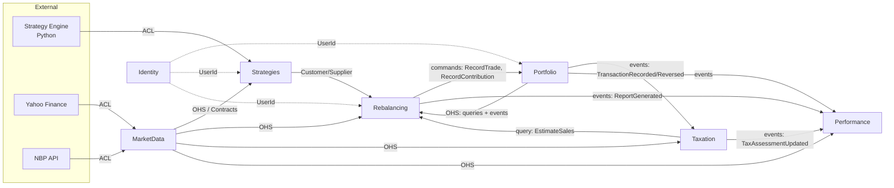
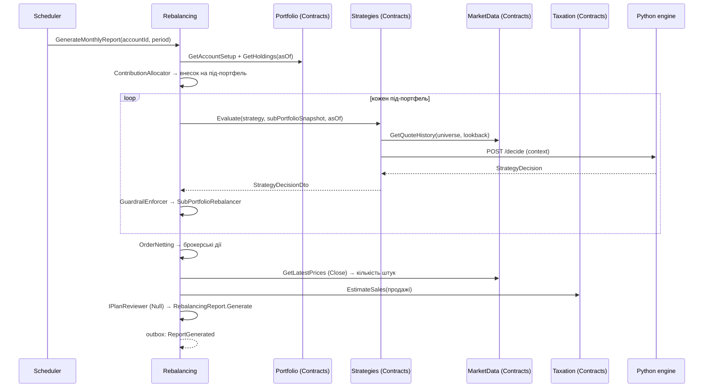

# План міграції: Investment Strategy Lab → .NET модулярний моноліт

> Статус: **ЗАТВЕРДЖЕНО, У РОБОТІ** (відкриті питання §15 прийнято за пропозиціями; прискорення й відмова від Wolverine — D12, D13; рапорт на вимогу — D14)
> Дата: 2026-10-25
> Обсяг: повна специфікація архітектури (DDD), структура репозиторію, етапи міграції.

---

## 0. Зміст

1. [Мета й межі](#1-мета-й-межі)
2. [Зафіксовані рішення](#2-зафіксовані-рішення)
3. [Технологічний стек](#3-технологічний-стек)
4. [Єдина мова (Ubiquitous Language)](#4-єдина-мова-ubiquitous-language)
5. [Bounded Contexts і карта контекстів](#5-bounded-contexts-і-карта-контекстів)
6. [Специфікація контекстів](#6-специфікація-контекстів)
7. [Ключові наскрізні сценарії](#7-ключові-наскрізні-сценарії)
8. [Правила коду (C#)](#8-правила-коду-c)
9. [Модулярний моноліт → мікросервіси](#9-модулярний-моноліт--мікросервіси)
10. [Структура репозиторію і фолдерів](#10-структура-репозиторію-і-фолдерів)
11. [Frontend (Angular)](#11-frontend-angular)
12. [Strategy Engine (Python-сайдкар)](#12-strategy-engine-python-сайдкар)
13. [Тестування](#13-тестування)
14. [Етапи міграції](#14-етапи-міграції)
15. [Відкриті питання на затвердження](#15-відкриті-питання-на-затвердження)

---

## 1. Мета й межі

**Мета.** Перетворити поточний Python-інструмент (GitHub Actions + `positions.json` + HTML-звіти)
на веб-сервіс, де користувач:

- логіниться;
- налаштовує рахунок із **віртуальними під-портфелями**, кожен зі своєю стратегією та цільовою часткою;
- щомісяця отримує на дашборді **рапорт** — робочий документ із діями для ребалансування;
- відмічає в рапорті фактичне виконання (виконано / частково / пропущено, фактичні ціни, угоди поза планом);
- бачить на дашборді вартість, дохідність (TWR, XIRR), алокацію, план vs факт і оцінку **податку Белки**.

**Поза межами першої версії:** email/Telegram, AI-рецензент (лише порт), JSON-пайплайн і C#-стратегії
(лише порт), інтеграції з API брокерів, мультивалютні рахунки, крім EUR/USD із податком у PLN.

---

## 2. Зафіксовані рішення

| # | Рішення |
|---|---|
| D1 | Модулярний моноліт на .NET; кожен модуль — окремий bounded context, готовий до виділення в мікросервіс. |
| D2 | **Віртуальні під-портфелі** в межах одного брокерського рахунку. Комбінована стратегія = рахунок з N під-портфелями. |
| D3 | Цільові частки під-портфелів фіксовані; **внесок іде тому, хто найбільше відстає** (`FillUnderweight`). Альтернатива — `FixedSplit`. |
| D4 | Спільний порт `IStrategyEngine`. Реалізації: Python-сайдкар (зараз), JSON-пайплайн і C#-код (потім), AI (потім). |
| D5 | Стратегія видає **цілі, а не ордери**. Ордери рахує детермінований ребалансер у .NET. Guardrails перевіряються після будь-якої стратегії. |
| D6 | Ціни належать модулю `MarketData` (кеш у БД, нічне завантаження), а не стратегії. Провайдер за портом, спочатку yfinance через Python `/prices`. |
| D7 | Рапорт — робочий документ. **Ledger змінюється тільки фактичними відмітками**, не планом. Внесок — окрема дія в рапорті. |
| D8 | Податок рахується **на рівні рахунку** (FIFO), розподіляється на під-портфель-продавця. Розрахунок — чиста функція над історією. `ITaxPolicy` складається з блоків. |
| D9 | Графіки будуються зі щоденних знімків, які похідні від ledger-а. Зміни заднім числом інвалідують знімки від дати зміни. |
| D10 | AI-рецензент — порт `IPlanReviewer` + `NullPlanReviewer`; місце в рапорті й життєвому циклі зарезервоване. |
| D11 | Без пошти й Telegram на старті; сповіщення тільки в застосунку. |
| D12 | **Прискорення розробки** (2026-10-25): великі кроки з комітом на під-етап; тести тільки для важливого — доменні правила й розрахунки (ребалансер, податки, TWR, розклади, якість котирувань), golden-тести, ArchitectureTests і **один наскрізний integration-тест на етап**. Без тестів для DTO, endpoint-ів, конфігурації й «проводки». Валідація вводу — у фабриках VO (`TryOf`), без FluentValidation. |
| D13 | **Без Wolverine** (2026-10-25): для одного процесу він заважкий (кодогенерація під час старту, Roslyn/MSBuild у залежностях, неявні транзакції). Замість нього — власний outbox/inbox (~300 рядків) + планувальник на `BackgroundService`; команди й запити — прямий виклик handler-а через DI. ADR-0003 оновлено. |
| D14 | **Рапорт на вимогу** (2026-10-25): щомісячний рапорт можна згенерувати будь-коли кнопкою «Згенерувати рапорт» (`POST /api/rebalancing/accounts/{accountId}/reports`) — той самий use case `GenerateMonthlyReport`, що й у задачі за розкладом; рапорт зберігає `Trigger` (`Scheduled` / `OnDemand`). Правила: (1) рапорт рахується на останніх котируваннях у БД; якщо вони застарілі, у `Warnings` є попередження, а в UI — кнопка «Оновити котирування» (`POST /api/market-data/quotes/ingest`) перед генерацією; (2) якщо за період уже є відкритий рапорт, новий його **замінює** (`SupersedeBy`): уже зроблені відмітки лишаються в ledger-і, новий план рахується від фактичних позицій і кешу, тому не повторює виконане; (3) внесок, уже відмічений як виконаний у цьому періоді, повторно не планується; сума внеску на вимогу може бути змінена користувачем; (4) задача за розкладом **не чіпає** рахунок, для якого вже є відкритий рапорт за поточний період (рапорт користувача не перезаписується автоматично). |

---

## 3. Технологічний стек

### Backend
| Область | Вибір | Примітка |
|---|---|---|
| Runtime | **.NET 10 (LTS), C# 14** | extension members, `field`, null-conditional assignment, collection expressions, primary constructors |
| Solution | `.slnx`, Central Package Management (`Directory.Packages.props`) | |
| API | ASP.NET Core Minimal APIs, `MapGroup` на модуль, вбудований OpenAPI | Типізовані результати `TypedResults` |
| Messaging | **Власний легкий outbox/inbox** у схемі кожного модуля + `BackgroundService`-диспетчер; handler-и викликаються напряму через DI (без шини) | Рішення D13: замість Wolverine. Пізніше диспетчер outbox можна перемкнути на RabbitMQ без зміни handler-ів (див. §9) |
| ORM / БД | EF Core 10 + **PostgreSQL**; окрема схема і `DbContext` на модуль | named query filters для `OwnerId` |
| Фонові задачі | Власний планувальник (`BackgroundService` з розкладом у часовому поясі) | нічні котирування, щомісячні рапорти, щотижневий ризик |
| Auth | ASP.NET Core Identity, cookie-автентифікація (BFF, same-origin) + Google login (опційно) | без JWT у localStorage |
| Оркестрація dev | **.NET Aspire** AppHost: Postgres, Python-сайдкар, Angular dev server | |
| Логи/телеметрія | OpenTelemetry через Aspire ServiceDefaults | |
| Тести | xUnit v3, Shouldly/AwesomeAssertions, Testcontainers, Verify (snapshot), ArchUnitNET | |

### Frontend
| Область | Вибір |
|---|---|
| Framework | **Angular 21+** (остання стабільна на старті): standalone, zoneless, signals |
| Дані | `resource` / `httpResource`, feature store на signals |
| Форми | Signal Forms (якщо стабільні на старті) або typed reactive forms |
| UI-кіт | **PrimeNG** (пресет Aura → власний пресет) + безкоштовний шаблон **Sakai**, Tailwind + `tailwindcss-primeui` для layout-у (див. §11) |
| Графіки | `p-chart` (Chart.js) з палітрою з токенів теми |
| API-клієнт | генерація з OpenAPI (`ng-openapi-gen` або orval) |
| Тести | Vitest + Angular Testing Library, Playwright (e2e) |

### Strategy Engine
Python 3.12+, FastAPI, наявний код `finance_decisions` (scanner, risk, backtest), `uv`.

---

## 4. Єдина мова (Ubiquitous Language)

Код англійською, UI українською. Назви в коді відповідають бізнес-термінам **один до одного**.

| Українською (UI) | У коді | Контекст | Визначення |
|---|---|---|---|
| Рахунок | `InvestmentAccount` | Portfolio | Реальний брокерський рахунок користувача. |
| Під-портфель | `SubPortfolio` | Portfolio | Віртуальна частина рахунку, якою керує одна стратегія. |
| Цільова частка | `TargetShare` | Portfolio | Частка рахунку, яку має займати під-портфель. Сума часток = 100%. |
| Політика внесків | `ContributionPolicy` | Portfolio | Як щомісячний внесок ділиться між під-портфелями. |
| Обмеження | `Guardrails` | Portfolio | Жорсткі межі під-портфеля: макс. вага позиції, макс. turnover, дозволений універсум. |
| Операція | `Transaction` | Portfolio | Запис у журналі: угода, внесок, вивід, трансфер, податок, комісія, коригування. |
| Угода | `Trade` | Portfolio | Купівля або продаж інструмента за фактичною ціною. |
| Позиція | `Holding` | Portfolio | Кількість інструмента в під-портфелі (похідна з операцій). |
| Звірка | `Reconciliation` | Portfolio | Порівняння ledger-а з виписки брокера і коригування розбіжностей. |
| Інструмент | `Instrument` | MarketData | ETF, індекс, валютна пара. Ідентифікується за ISIN. |
| Котирування | `DailyQuote` | MarketData | Ціна закриття (`Close`) і скоригована ціна (`AdjustedClose`) за день. |
| Курс валюти | `FxRate` | MarketData | Курс NBP/ECB на дату. |
| Тип стратегії | `StrategyType` | Strategies | Алгоритм (наприклад, `etf-momentum`), реалізований рушієм. |
| Стратегія | `Strategy` | Strategies | Налаштований екземпляр типу: параметри, універсум. |
| Версія стратегії | `StrategyVersion` | Strategies | Незмінний знімок параметрів. Рапорт посилається на конкретну версію. |
| Рішення стратегії | `StrategyDecision` | Strategies | Цільові ваги, частка інвестування, сигнали ризику, обґрунтування. |
| Цільова вага | `TargetWeight` | Strategies | Частка інструмента в під-портфелі. |
| Сигнал ризику | `RiskSignal` | Strategies | Попередження або вихід по позиції (стоп, MA, просідання). |
| Обґрунтування | `Rationale` | Strategies | Чому стратегія вирішила саме так (метрики, фільтри). |
| Рапорт | `RebalancingReport` | Rebalancing | Робочий документ із діями на період. |
| Дія | `ReportAction` | Rebalancing | Один крок: внести, продати, купити, запаркувати, розпаркувати. |
| Виконання | `Fill` | Rebalancing | Фактична кількість, ціна, комісія, дата для дії. |
| Пропуск | `Skip` | Rebalancing | Свідома відмова від дії з причиною. |
| Неттінг | `OrderNetting` | Rebalancing | Згортання протилежних дій під-портфелів у одну брокерську угоду. |
| Рецензія | `PlanReview` | Rebalancing | (майбутнє) Оцінка плану AI-рецензентом. |
| Податкова політика | `TaxPolicy` | Taxation | Набір правил оподаткування (`PL-Belka`, `PL-IKE`). |
| Податковий лот | `TaxLot` | Taxation | Партія купівлі для FIFO. |
| Реалізація | `Realization` | Taxation | Зіставлення продажу з лотами: виручка, витрати, зиск. |
| Податкова оцінка | `TaxAssessment` | Taxation | Розрахунок податку за рік для рахунку. |
| Знімок вартості | `ValuationSnapshot` | Performance | Вартість, кеш, внески, індекс TWR на дату. |
| Тіньовий портфель | `ShadowPortfolio` | Performance | Сценарій «якби все за планом» (або альтернатива AI). |

---

## 5. Bounded Contexts і карта контекстів

| Контекст | Тип субдомену | Відповідальність |
|---|---|---|
| **Identity** | Generic | Користувачі, вхід, профіль (валюта відображення, мова). |
| **MarketData** | Supporting | Довідник інструментів, котирування, курси валют, якість даних. |
| **Strategies** | Core | Каталог типів, налаштовані стратегії та їхні версії, виклик рушіїв, стан стратегій. |
| **Portfolio** | Core | Рахунки, під-портфелі, цільові частки, журнал операцій, позиції, звірка. |
| **Rebalancing** | Core | Генерація рапортів (розподіл внеску, ребалансер, неттінг, guardrails), робота з рапортом. |
| **Taxation** | Supporting | Податкові політики, лоти, реалізації, річна оцінка, оцінка для плану. |
| **Performance** | Supporting | Щоденні знімки, TWR/XIRR, просідання, тіньові портфелі. |

### Карта контекстів



**Правила напрямку:**
- `Portfolio` — upstream для `Rebalancing`. Рапорти про портфель знають, а портфель про рапорти ні. Rebalancing надсилає **команди** `RecordTrade` / `RecordContribution` з посиланням `SourceReference = ReportActionId`. Portfolio відповідає подіями `TransactionRecorded` або `TransactionRejected`.
- `MarketData` — Open Host Service для всіх. Ніхто, крім нього, не ходить до провайдерів даних.
- `Taxation` і `Performance` тримають **власні копії** потрібних даних (операції, плани), отримані з подій. Це готує їх до виділення в окремі сервіси.
- Зовнішні системи (Python, Yahoo, NBP) підключаються тільки через Anti-Corruption Layer в `Infrastructure` відповідного модуля.

---

## 6. Специфікація контекстів

Позначення: **AR** — aggregate root, **E** — entity, **VO** — value object, **DS** — domain service,
**DE** — domain event (всередині модуля), **IE** — integration event (у `Contracts`), **P** — порт (інтерфейс в Application, реалізація в Infrastructure).

### 6.1 SharedKernel (спільне ядро — мінімальне)

Лише стабільні концепції, однакові в усіх контекстах:

| Тип | Вид | Примітка |
|---|---|---|
| `Money` | VO | `Amount` (decimal) + `Currency`. Арифметика тільки в межах однієї валюти. |
| `Currency` | VO | ISO 4217 (`EUR`, `USD`, `PLN`). |
| `Percentage` | VO | Частка 0..1 (з можливістю від'ємних для дохідності: `SignedPercentage`). |
| `Quantity` | VO | Кількість штук, підтримка дробових; ≥ 0. |
| `Price` | VO | `Money` за одиницю; > 0. |
| `Isin` | VO | Валідація контрольної суми ISIN. |
| `YearMonth` | VO | Період рапорту. |
| `UserId` | VO (strongly typed id) | Власник даних. |
| `Entity<TId>`, `AggregateRoot<TId>`, `IDomainEvent` | будівельні блоки | |
| `Result`, `Result<T>`, `Error` | будівельні блоки | Помилки домену без винятків. |

> Ідентифікатори конкретних агрегатів (`AccountId`, `ReportId`…) живуть у своїх модулях, а не в SharedKernel. У `Contracts` вони передаються як `Guid`.

### 6.2 Identity

| Елемент | Вид | Опис |
|---|---|---|
| `User` | AR (ASP.NET Identity) | Email, пароль/зовнішній логін. |
| `UserProfile` | AR | `DisplayCurrency`, `Locale`, `TimeZone`. |
| `UserRegistered` | IE | Інші модулі можуть створити дефолтні дані. |

Ізоляція даних: кожен агрегат в інших модулях має `OwnerId: UserId`; EF named query filter `"Owner"` фільтрує за поточним користувачем.

### 6.3 MarketData

**Агрегати**

| Елемент | Вид | Інваріанти / поведінка |
|---|---|---|
| `Instrument` | AR | `InstrumentId`, `Isin?` (обов'язковий для ETF), `Name`, `Exchange`, `TradingCurrency`, `InstrumentKind` (Etf, Index, FxPair), `Group` (напр. «S&P 500»), `IsAccumulating?`. Метод `AssignProviderSymbol(provider, symbol)` — один символ на провайдера. |
| `ProviderSymbol` | VO | `QuoteProvider` + `Symbol` (`yfinance:SXR8.DE`). |
| `QuoteCorrection` | AR | Ручне виправлення ціни з причиною й автором; аудит. |

**Дані (не агрегати — часові ряди великого обсягу)**

| Елемент | Вид | Опис |
|---|---|---|
| `DailyQuote` | VO / рядок часового ряду | `InstrumentId`, `TradingDate`, `Close`, `AdjustedClose`, `Source`, `FetchedAt`, `QualityFlags`. |
| `FxRate` | VO / рядок | `Source` (NBP, ECB), `Base`, `Quote`, `EffectiveDate`, `Rate`, `TableNumber?`. |
| `QualityFlags` | VO (flags) | `Stale`, `Gap`, `Spike`, `Corrected`. |

**Доменні сервіси:** `QuoteQualityInspector` (позначає застарілі дані, пропуски, стрибки), `FxRateResolver` («останній робочий день перед датою» з урахуванням свят).

**Порти:** `IQuoteProvider` (→ `YFinanceQuoteProvider` через Python `/prices`, пізніше `EodhdQuoteProvider`), `IFxRateProvider` (→ `NbpFxRateProvider`, `EcbFxRateProvider`).

**Use cases (Application, по фічах):**
`RegisterInstrument`, `AssignProviderSymbol`, `IngestDailyQuotes` (нічна задача), `CorrectQuote`, `IngestFxRates`, `GetQuoteHistory` (query), `GetLatestPrices` (query), `GetFxRate` (query).

**Contracts:** `IInstrumentCatalog` (`GetInstruments`), `IQuoteHistory` (`GetQuoteHistory`, `GetLatestPrices`), `IFxRates` (`GetFxRate`); IE: `DailyQuotesIngested(date, instrumentIds)`, `QuoteCorrected(instrumentId, date)`.

### 6.4 Strategies

**Агрегати**

| Елемент | Вид | Інваріанти / поведінка |
|---|---|---|
| `Strategy` | AR | `StrategyId`, `OwnerId`, `Name`, `StrategyTypeCode`, `Universe` (список `InstrumentId`), `RebalanceFrequency`, список `StrategyVersion`. `Reconfigure(parameters, universe)` створює **нову версію**; старі версії незмінні. Параметри валідуються JSON Schema типу. Універсум не може бути порожнім. |
| `StrategyVersion` | E | `VersionNumber`, `Parameters` (VO `StrategyParameters`, JSON), `UniverseSnapshot`, `CreatedAt`. |
| `StrategyState` | AR | Стан між запусками для стратегій зі станом; ключ `(StrategyId, SubPortfolioId)`. |

**Value objects:** `StrategyTypeCode`, `StrategyParameters`, `RebalanceFrequency` (Monthly, Weekly), `StrategyDecision`, `TargetWeight` (`InstrumentId` + `Percentage`), `InvestFraction`, `RiskSignal` (`InstrumentId`, `RiskSignalKind`: Warn/Exit, `Reason`, `ExitPrice?`), `Rationale` (структуровані метрики + текст), `InstrumentScore` (метрики для таблиці «чому так»).

**Каталог типів:** `StrategyTypeDescriptor` (код, назва, опис, JSON Schema параметрів, рушій, підтримка стану). Каталог наповнюється з коду та з `/schema` Python-сайдкара.

**Порти:**
- `IStrategyEngine` — `Task<StrategyDecision> DecideAsync(StrategyEvaluationContext ctx, CancellationToken ct)`. Реалізації: `PythonStrategyEngine` (HTTP), пізніше `PipelineStrategyEngine`, `CodeStrategyEngine`, `AiStrategyEngine`.
- `IStrategyEngineResolver` — вибір рушія за `StrategyTypeCode`.

**`StrategyEvaluationContext`** (серіалізований знімок, без доступу назовні): `AsOf`, `SubPortfolioSnapshot` (позиції, лоти, кеш, внесок), `MarketSeries` (котирування `AdjustedClose`/`Close` до `AsOf`, з прапорцями якості, VIX), `Parameters`, `State?`.

**Use cases:** `CreateStrategy`, `ReconfigureStrategy`, `ArchiveStrategy`, `EvaluateStrategy` (будує контекст, викликає рушій, зберігає новий стан, повертає рішення), `EvaluateRisk` (щотижневий ризик), `GetStrategyCatalog`, `GetStrategy`.

**Contracts:** `IStrategyEvaluation.EvaluateAsync(strategyId, version, subPortfolioSnapshot, asOf)` → `StrategyDecisionDto`; IE: `StrategyReconfigured`.

### 6.5 Portfolio

**Агрегати**

| Елемент | Вид | Інваріанти / поведінка |
|---|---|---|
| `InvestmentAccount` | AR | `AccountId`, `OwnerId`, `Name`, `Broker`, `BaseCurrency`, `TaxPolicyCode`, `ContributionPolicy`, `SubPortfolios`. **Сума `TargetShare` активних під-портфелів = 100%.** Методи: `AddSubPortfolio`, `ChangeTargetShares` (атомарно для всіх), `AssignStrategy`, `RetireSubPortfolio`, `ChangeContributionPolicy`. |
| `SubPortfolio` | E | `SubPortfolioId`, `Name`, `TargetShare`, `StrategyRef` (`StrategyId` + політика версії: остання або закріплена), `CashInstrumentId?` (ETF для паркування, напр. XEON), `Guardrails`, `Status`. |
| `Transaction` | AR | Незмінний запис журналу. `TransactionId`, `AccountId`, `TransactionKind`, `OccurredOn`, `Source` (`ReportAction(id)`, `Manual`, `Reconciliation`, `Import`), `ReversalOf?`. Варіанти тіла: `TradeDetails` (інструмент, `TradeSide`, `Quantity`, `Price`, `Fee`, розподіл по під-портфелях), `CashMovementDetails` (внесок, вивід, комісія, сплата податку, дивіденд), `InternalTransferDetails` (з під-портфеля в під-портфель: інструмент або кеш). Метод `Reverse(reason)` створює сторно-операцію, оригінал не змінюється. |
| `Reconciliation` | AR | Виписка брокера на дату (позиції, кеш), обчислені розбіжності, рішення по кожній (`AcceptAsAdjustment(subPortfolioId)`, `Ignore`). Прийнята розбіжність породжує `Transaction` з `Source = Reconciliation`. |

**Value objects:** `TargetShare`, `ContributionPolicy` (`FillUnderweight` | `FixedSplit`, плюс `DriftBand` для пропозиції внутрішнього трансферу), `Guardrails` (`MaxPositionWeight`, `MaxMonthlyTurnover`, `AllowLeverage=false`), `Allocation` (`SubPortfolioId` + `Quantity`/`Money`), `TradeSide`, `TransactionSource`, `Broker`.

**Read model (проєкція в тому ж модулі, оновлюється в тій самій транзакції):**
`Holdings` — на під-портфель: позиції (`Quantity`, віртуальна середня вартість, віртуальні лоти) + кеш у валюті рахунку.

**Доменні сервіси:**
- `TransactionRecorder` — перевіряє операцію щодо поточних `Holdings` (не можна продати більше, ніж є в під-портфелі; розподіл має сумуватися до кількості угоди; не можна купити на більше, ніж кеш, якщо внесок не зафіксовано — попередження, а не помилка) і записує її.
- `TradeAllocator` — розподіляє брокерську угоду між під-портфелями пропорційно плановим частинам (якщо розподіл не задано явно).

**Use cases:** `OpenAccount`, `AddSubPortfolio`, `ChangeTargetShares`, `AssignStrategy`, `ChangeContributionPolicy`, `RecordTrade`, `RecordContribution`, `RecordCashMovement`, `RecordInternalTransfer`, `ReverseTransaction`, `StartReconciliation`, `ResolveDifference`, `ImportPositions` (одноразовий імпорт `positions.json`), queries: `GetAccount`, `GetHoldings`, `GetTransactions`.

**Contracts:**
- команди: `RecordTrade`, `RecordContribution` (з `SourceReference`, ідемпотентність за ним);
- queries: `IAccountSetupQueries` (`GetAccountSetup`), `IHoldingsQueries` (`GetHoldings(asOf)`, `GetSubPortfolioSnapshot`);
- IE: `TransactionRecorded`, `TransactionReversed`, `TransactionRejected(sourceReference, reason)`, `TargetSharesChanged`, `SubPortfolioAdded`.

### 6.6 Rebalancing

**Агрегат `RebalancingReport` (AR)**

| Поле | Тип |
|---|---|
| `ReportId` | strongly typed id |
| `AccountId`, `OwnerId` | |
| `Period` | `YearMonth` |
| `Kind` | `ReportKind`: `Monthly`, `Recalculation`, `RiskReview` (щотижневий) |
| `Trigger` | `ReportTrigger`: `Scheduled`, `OnDemand` (D14) |
| `Status` | `ReportStatus`: `New`, `InProgress`, `Closed`, `Superseded` |
| `MarketAsOf` | дата котирувань, на яких рахувався план |
| `ContributionPlan` | VO: сума, розподіл по під-портфелях, обрана політика |
| `Sections` | E `ReportSection` на під-портфель: `StrategyRef` + версія, знімок `StrategyDecision`, `Rationale`, алокація до/після |
| `Actions` | E `ReportAction` (див. нижче) — **рівень брокера, після неттінгу** |
| `TaxEstimate` | VO: оцінка податку від продажів у плані |
| `Review` | VO `PlanReview?` (зарезервовано під AI) |
| `Warnings` | VO (якість даних, guardrails, які обрізали ціль) |
| `SupersededBy` | `ReportId?` |

**Сутність `ReportAction` (E)**

| Поле | Тип |
|---|---|
| `ReportActionId` | |
| `Kind` | `ActionKind`: `Contribute`, `Sell`, `Buy`, `Park`, `Unpark` |
| `Instrument` | `InstrumentId?` (немає для `Contribute`) |
| `PlannedQuantity`, `PlannedPrice`, `PlannedAmount` | `Quantity`, `Price`, `Money` |
| `PlannedAllocations` | список `Allocation` по під-портфелях (розбивка неттінгу) |
| `Reason` | текст із правила (exit, trim, top-up…) |
| `TaxEstimate` | VO для продажів |
| `Status` | `ActionStatus`: `Pending`, `Executed`, `PartiallyExecuted`, `Skipped` |
| `Fills` | список VO `Fill` (`Quantity`, `Price`, `Fee`, `ExecutedOn`, `TransactionId?`) |
| `SkipReason` | VO `SkipReason?` |

**Поведінка й інваріанти**

| Метод | Правило |
|---|---|
| `MarkExecuted(Fill fill)` | Тільки в `New`/`InProgress`. Ціна й кількість за замовчуванням планові, але змінні. Статус дії → `Executed`. Подія `ActionFillRecorded`. |
| `RecordPartialFill(Fill fill, string? note)` | Сума кількостей < планової (з толерантністю на округлення). Можна викликати кілька разів. Статус → `PartiallyExecuted`. |
| `Skip(SkipReason reason)` | Тільки `Pending`. |
| `UndoMark(ReportActionId)` | Повертає дію в `Pending`; подія `ActionMarkUndone` → Portfolio сторнує пов'язані операції. |
| `ApplyTransactionResult(...)` | Прив'язує `TransactionId` до `Fill` або відкочує відмітку при `TransactionRejected` (з повідомленням). |
| `Close(UnmarkedActionsPolicy)` | Невідмічені дії стають `Skipped` («закрито без відмітки»). Статус → `Closed`. |
| `SupersedeBy(ReportId)` | Для перерахунку або нового місячного рапорту, якщо попередній відкритий. |
| Статус рапорту | `New` → `InProgress` при першій відмітці → `Closed` автоматично, коли всі дії мають фінальний статус. |

**Доменні сервіси (планування — чисті функції, перенесення логіки `plan.py`)**

| Сервіс | Відповідальність |
|---|---|
| `ContributionAllocator` | Розподіл внеску між під-портфелями (`FillUnderweight`, `FixedSplit`), пропозиція внутрішнього трансферу при виході за `DriftBand`. |
| `SubPortfolioRebalancer` | Рішення стратегії + позиції + кеш + внесок → ордери під-портфеля. Правила з `plan.py`: вихід із невибраних, invest fraction у слабкому ринку, `1/top_n` на позицію, top-up, trim тільки в плюсі й понад `TrimBand`, `MinTrade`, дробові акції, park/unpark у cash ETF. |
| `GuardrailEnforcer` | Обрізає цілі, які порушують `Guardrails`; додає `Warnings`. |
| `OrderNetting` | Згортає ордери під-портфелів у брокерські дії + внутрішні трансфери. |
| `RebalancingPolicy` | VO з параметрами: `MinTrade`, `TrimBand`, `AllowFractionalShares`, `TaxAwareTrim?`. |

**Порти:** `IPlanReviewer` (→ `NullPlanReviewer`).

**Use cases:** `GenerateMonthlyReport` (задача за розкладом і кнопка «на вимогу» — правила D14), `GenerateRiskReview` (щотижнева задача), `RecalculateReport`, `MarkActionExecuted`, `RecordPartialFill`, `SkipAction`, `UndoActionMark`, `CloseReport`, `RecordOffPlanTrade` (проксі в Portfolio з прив'язкою до відкритого рапорту), queries: `GetReport`, `ListReports`, `GetOpenActionsCount`.

**Contracts:** IE `ReportGenerated` (з плановими діями — для тіньового портфеля), `ReportClosed`, `ReportSuperseded`.

### 6.7 Taxation

**Агрегати**

| Елемент | Вид | Інваріанти / поведінка |
|---|---|---|
| `TaxAssessment` | AR | Ключ `(AccountId, TaxYear)`. `PolicyCode`, `PolicyVersion`, `InputHash`, `ComputedAt`, `Lots`, `Realizations`, `Summary`. `Recompute(TaxLedger, ITaxPolicy)` — повністю перебудовує результат; якщо `InputHash` не змінився, нічого не робить. |
| `TaxLot` | E | `InstrumentId`, `AcquiredOn`, `RemainingQuantity`, `CostInTaxCurrency`, `FxRate`, `FxRateDate`, `AcquisitionFee`, `SourceTransactionId`. |
| `Realization` | E | `SaleTransactionId`, зіставлені лоти (`LotId`, `Quantity`), `Proceeds`, `Cost`, `Gain`, `AttributedSubPortfolioId`. |
| `TaxLedger` | AR | Власна копія оподатковуваних операцій рахунку (з подій Portfolio). |
| `LossCarryforward` | AR | Збитки минулих років, введені користувачем: рік, сума, використано. |

**Value objects:** `TaxYear`, `TaxPolicyCode`, `TaxYearSummary` (`Revenue`, `Costs`, `Gain`, `CarryforwardUsed`, `TaxBase`, `TaxDue`), `TaxEstimate` (`EstimatedGain`, `EstimatedTax`, `FxRateUsed`, `IsFinal`).

**Політика як композиція (DS):**

```
ITaxPolicy
 ├─ ILotMatcher            FIFO | LIFO | HIFO | AverageCost | UkSection104Pool
 ├─ IFxConversionRule      NbpPreviousBusinessDay(TradeDate|SettlementDate) | Ecb | None
 ├─ ITaxRateSchedule       Flat(0.19) | ...
 ├─ INettingRule           AnnualNetting | PerTransaction
 ├─ ILossCarryforwardRule  Pl5Years50Percent | Unlimited | None
 └─ IRoundingRule          PlWholeZloty | None

BelkaTaxPolicy  = FIFO + NbpPreviousBusinessDay + Flat(19%) + AnnualNetting + Pl5Years50Percent + PlWholeZloty
NoTaxPolicy     = IKE / IKZE
```

**Use cases:** `RecomputeAssessment` (на `TransactionRecorded/Reversed`, `QuoteCorrected` не впливає, `FxRate` — так), `EstimateSales` (query для плану), `RecordLossCarryforward`, `GetAssessment`.

**Contracts:** `ITaxEstimator.EstimateSalesAsync(accountId, proposedSales, asOf)`; IE `TaxAssessmentUpdated(accountId, year)`.

> ⚠️ Розрахунок — оцінка. Дату курсу (дата угоди vs дата розрахунку) зроблено налаштуванням політики. Авторитетні — PIT-8C брокера / податковий консультант. У UI постійний дисклеймер.

### 6.8 Performance

**Агрегати / моделі**

| Елемент | Вид | Опис |
|---|---|---|
| `ShadowPortfolio` | AR | `(AccountId, Scenario)`: `FullPlan` або `Alternative(reviewId)`. Застосовує планові дії з `ReportGenerated` за плановими цінами. |
| `PerformanceLedger` | AR | Власна копія операцій (з подій Portfolio) і цільових часток. |
| `RecalculationMarker` | AR | `(AccountId, DirtyFrom)`; зсувається тільки назад. |
| `ValuationSnapshot` | read model | `(AccountId, SubPortfolioId?, Date)`: `MarketValue`, `Cash`, `NetContributions`, `TwrIndex`, `Unrealized`, `RealizedYtd`, `TaxAccrued`. |
| `PositionSnapshot` | read model | Позиція на дату: кількість, ціна, вартість, вага, цільова вага. |

**Доменні сервіси:** `ValuationCalculator`, `TwrCalculator` (ланцюжкові денні дохідності, потоки на початок дня), `XirrCalculator`, `DrawdownCalculator`, `ShadowPortfolioSimulator`.

**Use cases:** `RebuildSnapshots(accountId, from)` (фонова задача), `MarkDirty` (на події), `GetDashboard`, `GetValueSeries`, `GetPerformance(period)`, `GetPlanVsActual`, `GetAllocation`.

**Contracts:** немає вихідних команд; споживає `TransactionRecorded/Reversed`, `ReportGenerated`, `DailyQuotesIngested`, `QuoteCorrected`, `TaxAssessmentUpdated`, `TargetSharesChanged`.

---

## 7. Ключові наскрізні сценарії

### 7.1 Щомісячний рапорт



### 7.2 Відмітка виконання

1. UI → `POST /reports/{id}/actions/{actionId}/fills` (кількість, ціна, комісія, дата).
2. `RebalancingReport.MarkExecuted` → DE `ActionFillRecorded` → outbox → команда `RecordTrade` в Portfolio (`SourceReference = actionId:fillNo`).
3. Portfolio: `TransactionRecorder` → `Transaction` + оновлення `Holdings` → IE `TransactionRecorded`.
4. Rebalancing: `ApplyTransactionResult` прив'язує `TransactionId`. При `TransactionRejected` відмітка відкочується, і користувач бачить причину.
5. Taxation: `RecomputeAssessment` → `TaxAssessmentUpdated`.
6. Performance: `MarkDirty(from = executedOn)` → `RebuildSnapshots`.
7. UI оновлюється (polling `httpResource` або SSE — див. §15).

Ідемпотентність: inbox споживача + унікальний індекс на `Transaction.SourceReference`.

### 7.3 Сторно (скасування відмітки)
`UndoActionMark` → DE `ActionMarkUndone` → `ReverseTransaction` у Portfolio → `TransactionReversed` → Taxation і Performance перераховують.

### 7.4 Щотижневий ризик
Scheduler → `GenerateRiskReview` → `Strategies.EvaluateRisk` по кожному під-портфелю → рапорт `Kind = RiskReview` з діями `Sell` тільки для сигналів `Exit` і попередженнями для `Warn`.

---

## 8. Правила коду (C#)

### 8.1 Загальні
- File-scoped namespaces, `global using` на проєкт, `nullable enable`, `TreatWarningsAsErrors`.
- Назви класів і методів — бізнес-мовою з §4. Без `Manager`, `Helper`, `Util`, `Data`.
- Агрегат змінюється тільки через методи з бізнес-назвами (`MarkExecuted`, `ChangeTargetShares`), без публічних сеттерів.
- Помилки домену — `Result`/`Error`, не винятки. Винятки — тільки для порушення програмних контрактів.
- Один агрегат на транзакцію; між агрегатами — доменні події, між модулями — integration events / контракти.
- Primary constructors — для сервісів, handler-ів, endpoint-ів. **Не** для VO й агрегатів (там валідація у фабриках).

### 8.2 Value objects: `Of` замість `new`

```csharp
namespace InvestmentLab.SharedKernel;

public sealed record Money
{
    public decimal Amount { get; }
    public Currency Currency { get; }

    private Money(decimal amount, Currency currency) => (Amount, Currency) = (amount, currency);

    public static Money Of(decimal amount, Currency currency) => new(decimal.Round(amount, 2), currency);
    public static Money Zero(Currency currency) => new(0m, currency);

    public Money Add(Money other) => Of(Amount + EnsureSameCurrency(other).Amount, Currency);
    public Money Subtract(Money other) => Of(Amount - EnsureSameCurrency(other).Amount, Currency);
    public Money Multiply(decimal factor) => Of(Amount * factor, Currency);

    public static Money operator +(Money left, Money right) => left.Add(right);
    public static Money operator -(Money left, Money right) => left.Subtract(right);

    private Money EnsureSameCurrency(Money other) =>
        other.Currency == Currency ? other : throw new CurrencyMismatchException(Currency, other.Currency);
}
```

Правила:
- конструктор `private`, властивості тільки `get` (тоді `with` не обійде валідацію);
- `Of(...)` — головна фабрика; для вводу користувача — `TryOf(...)` → `Result<T>`;
- додаткові фабрики з бізнес-назвами: `Money.Zero`, `Percentage.FromPercent(19)`, `Quantity.None`.

```csharp
public sealed record Percentage
{
    public decimal Value { get; }

    private Percentage(decimal value) => Value = value;

    public static Percentage Of(decimal fraction) =>
        fraction is >= 0m and <= 1m ? new(fraction) : throw new ArgumentOutOfRangeException(nameof(fraction));

    public static Result<Percentage> TryOf(decimal fraction) =>
        fraction is >= 0m and <= 1m ? new Percentage(fraction) : PercentageErrors.OutOfRange(fraction);

    public static Percentage FromPercent(decimal percent) => Of(percent / 100m);
}
```

### 8.3 Strongly typed ids

```csharp
public readonly record struct ReportId
{
    public Guid Value { get; }
    private ReportId(Guid value) => Value = value;

    public static ReportId New() => new(Guid.CreateVersion7());
    public static ReportId Of(Guid value) =>
        value != Guid.Empty ? new(value) : throw new ArgumentException("Empty report id", nameof(value));
}
```

### 8.4 Агрегат (приклад читається як бізнес-правило)

```csharp
public sealed class RebalancingReport : AggregateRoot<ReportId>
{
    private readonly List<ReportAction> _actions = [];

    public AccountId AccountId { get; }
    public YearMonth Period { get; }
    public ReportStatus Status { get; private set; }
    public IReadOnlyList<ReportAction> Actions => _actions;

    public Result RecordPartialFill(ReportActionId actionId, Fill fill, string? note)
    {
        if (!IsOpenForMarking)
            return ReportErrors.ReportIsNotOpen(Id, Status);

        if (FindAction(actionId) is not { } action)
            return ReportErrors.ActionNotFound(actionId);

        var result = action.RecordPartialFill(fill, note);
        if (result.IsFailure)
            return result;

        StartWorkIfNew();
        Raise(new ActionFillRecorded(Id, actionId, fill));
        CloseWhenAllActionsResolved();
        return Result.Success();
    }

    private bool IsOpenForMarking => Status is ReportStatus.New or ReportStatus.InProgress;
    // ...
}
```

### 8.5 Можливості C# 14, які використовуємо

| Можливість | Де |
|---|---|
| `field` у властивостях | валідація в сутностях без ручних backing fields: `public string Name { get; private set => field = Guard.NotBlank(value); }` |
| extension members (`extension(...)` блоки) | доменні розширення для колекцій VO: `extension(IEnumerable<Money> amounts) { public Money Total(Currency c) => ... }`; extension-властивості для DTO-мапінгу |
| null-conditional assignment | `report.Review?.Attach(...)`, `entity?.Prop = value` в мапінгу |
| collection expressions | `List<ReportAction> _actions = [];`, `[..sells, ..buys]` |
| primary constructors | handler-и, endpoint-и, сервіси інфраструктури |
| list/property patterns | правила ребалансера (`order is { Kind: ActionKind.Sell, Amount.Amount: < 25m }`) |
| `required` + `init` | тільки DTO та контракти, не домен |
| `Guid.CreateVersion7()` | сортовані ідентифікатори |

### 8.6 Vertical slice (use case)

Кожен use case — окрема папка: команда/запит, handler, валідатор, endpoint, DTO.

```csharp
// Reports/Application/RecordPartialFill/RecordPartialFillCommand.cs
public sealed record RecordPartialFillCommand(
    Guid ReportId, Guid ActionId, decimal Quantity, decimal Price, decimal Fee, DateOnly ExecutedOn, string? Note);

// Reports/Application/RecordPartialFill/RecordPartialFillHandler.cs
public sealed class RecordPartialFillHandler(IReportRepository reports, TimeProvider clock)
{
    public async Task<Result> Handle(RecordPartialFillCommand command, CancellationToken ct)
    {
        if (await reports.FindAsync(ReportId.Of(command.ReportId), ct) is not { } report)
            return ReportErrors.NotFound(command.ReportId);

        var fill = Fill.Of(Quantity.Of(command.Quantity), Price.Of(command.Price, report.Currency),
                           Money.Of(command.Fee, report.Currency), command.ExecutedOn);

        return report.RecordPartialFill(ReportActionId.Of(command.ActionId), fill, command.Note);
        // збереження + outbox — repository.SaveChangesAsync: interceptor пише integration events в outbox у тій самій транзакції
    }
}

// Reports/Api/RecordPartialFillEndpoint.cs
internal static class RecordPartialFillEndpoint
{
    public static RouteGroupBuilder MapRecordPartialFill(this RouteGroupBuilder group)
    {
        group.MapPost("/{reportId:guid}/actions/{actionId:guid}/partial-fills", async (
                Guid reportId, Guid actionId, PartialFillRequest body, RecordPartialFillHandler handler, CancellationToken ct) =>
            (await handler.Handle(body.ToCommand(reportId, actionId), ct)).ToHttpResult())
            .WithName("RecordPartialFill");
        return group;
    }
}
```

---

## 9. Модулярний моноліт → мікросервіси

Правила, які дозволять виділити будь-який модуль без переписування домену:

1. **Модуль = проєкт `InvestmentLab.<Module>` + проєкт `InvestmentLab.<Module>.Contracts`.** Інші модулі посилаються **тільки** на `Contracts`. Перевіряється ArchUnitNET у CI.
2. `Contracts` містить тільки: integration events, команди між модулями, інтерфейси запитів (`I<Module>Queries`) і DTO з примітивами (`Guid`, `decimal`, `string`, `DateOnly`). Ніяких доменних типів.
3. **Своя схема БД** (`marketdata`, `strategies`, `portfolio`, `rebalancing`, `taxation`, `performance`, `identity`) і свій `DbContext`. Без FK між схемами, без JOIN-ів між модулями.
4. Асинхронна взаємодія — через **власний outbox/inbox** (таблиці в схемі модуля, диспетчер — `BackgroundService`). Сьогодні доставка in-process, завтра — RabbitMQ без зміни handler-ів.
5. Синхронні запити між модулями (`IQuoteHistory`, `IFxRates`, `IAccountSetupQueries`, `IHoldingsQueries`, `ITaxEstimator`, `IStrategyEvaluation`) — інтерфейси в `Contracts`. Сьогодні — in-process реалізація, завтра — HTTP/gRPC-клієнт з тим самим інтерфейсом.
6. Модулі, яким потрібні чужі дані для своїх розрахунків (Taxation, Performance), **тримають копії** з подій, а не питають щоразу.
7. Кожен модуль реєструється через `IModule` (`AddServices`, `MapEndpoints`, `ConfigureMessaging`). Host нічого не знає про внутрішність модулів.
8. Ідемпотентні споживачі (ключ — `SourceReference`/id повідомлення).
9. Кандидати на виділення першими: `MarketData` (нічне завантаження, інше навантаження) і `Strategies` (поруч із Python-рушієм).

---

## 10. Структура репозиторію і фолдерів

### 10.1 Корінь репозиторію

```text
investment-strategy-lab/
├── backend/                        # .NET модулярний моноліт
├── frontend/                       # Angular
├── strategy-engine/                # Python: поточний finance_decisions + FastAPI
├── docs/
│   ├── architecture/
│   │   ├── migration-plan.md       # цей документ
│   │   └── adr/                    # ADR-0001-modular-monolith.md, ...
│   └── domain/
│       └── glossary.md
├── .github/workflows/
│   ├── backend.yml
│   ├── frontend.yml
│   ├── strategy-engine.yml
│   └── (legacy) monthly_scanner.yml, weekly_risk_monitor.yml — до кінця паралельного запуску
└── README.md
```

### 10.2 Backend

```text
backend/
├── InvestmentLab.slnx
├── global.json
├── Directory.Build.props            # net10.0, LangVersion, Nullable, TreatWarningsAsErrors
├── Directory.Packages.props         # Central Package Management
├── .editorconfig
├── src/
│   ├── Hosts/
│   │   ├── InvestmentLab.Api/                       # composition root
│   │   │   ├── Program.cs
│   │   │   ├── Modules.cs                           # реєстрація всіх IModule
│   │   │   ├── Auth/
│   │   │   └── appsettings*.json
│   │   ├── InvestmentLab.AppHost/                   # .NET Aspire: Postgres, Api, strategy-engine, frontend
│   │   └── InvestmentLab.ServiceDefaults/           # OpenTelemetry, health checks, resilience
│   │
│   ├── BuildingBlocks/
│   │   ├── InvestmentLab.SharedKernel/              # Money, Currency, Percentage, Quantity, Price, Isin, YearMonth,
│   │   │   ├── Domain/                              #   Entity, AggregateRoot, IDomainEvent
│   │   │   ├── Money/
│   │   │   ├── Time/
│   │   │   └── Results/                             #   Result, Result<T>, Error
│   │   └── InvestmentLab.BuildingBlocks/            # IModule, EF base (ModuleDbContext, конвертери VO),
│   │       ├── Modules/                             #   outbox-конфіг, OwnerId-фільтр, Result→HTTP
│   │       ├── Persistence/
│   │       ├── Messaging/
│   │       └── Http/
│   │
│   └── Modules/
│       ├── Identity/
│       │   ├── InvestmentLab.Identity/
│       │   └── InvestmentLab.Identity.Contracts/
│       ├── MarketData/
│       │   ├── InvestmentLab.MarketData/
│       │   └── InvestmentLab.MarketData.Contracts/
│       ├── Strategies/
│       │   ├── InvestmentLab.Strategies/
│       │   └── InvestmentLab.Strategies.Contracts/
│       ├── Portfolio/
│       │   ├── InvestmentLab.Portfolio/
│       │   └── InvestmentLab.Portfolio.Contracts/
│       ├── Rebalancing/
│       │   ├── InvestmentLab.Rebalancing/
│       │   └── InvestmentLab.Rebalancing.Contracts/
│       ├── Taxation/
│       │   ├── InvestmentLab.Taxation/
│       │   └── InvestmentLab.Taxation.Contracts/
│       └── Performance/
│           ├── InvestmentLab.Performance/
│           └── InvestmentLab.Performance.Contracts/
│
└── tests/
    ├── Modules/
    │   ├── InvestmentLab.MarketData.Tests/
    │   ├── InvestmentLab.Strategies.Tests/
    │   ├── InvestmentLab.Portfolio.Tests/
    │   ├── InvestmentLab.Rebalancing.Tests/
    │   ├── InvestmentLab.Taxation.Tests/
    │   └── InvestmentLab.Performance.Tests/
    ├── InvestmentLab.ArchitectureTests/             # правила залежностей між модулями та шарами
    ├── InvestmentLab.IntegrationTests/              # Testcontainers Postgres + strategy-engine
    └── InvestmentLab.GoldenTests/                   # .NET ребалансер vs Python plan.py на фікстурах
        └── Fixtures/
```

### 10.3 Всередині модуля: спершу фіча, всередині — Domain / Application / Infrastructure / Api

**Правило:** верхній рівень проєкту модуля — **бізнес-фічі** (можливості контексту). Кожна фіча має свої шари-папки.
Шар створюється тільки тоді, коли він фічі потрібен (наприклад, у `Planning` немає `Infrastructure`, у `Dashboard` немає `Domain`).

Namespace повторює шлях: `InvestmentLab.Rebalancing.Reports.Domain`, `InvestmentLab.Rebalancing.Planning.Application.GenerateMonthlyReport`.

**Залежності (перевіряє ArchUnitNET):**

| Звідки | Куди можна |
|---|---|
| `<Feature>/Domain` | `SharedKernel`, `Domain` інших фіч **цього ж** модуля (без циклів) |
| `<Feature>/Application` | свій `Domain`, `Domain` інших фіч модуля, `Contracts` інших модулів, `BuildingBlocks` |
| `<Feature>/Infrastructure` | свої `Application` і `Domain`, `Shared/Infrastructure` модуля, `BuildingBlocks` |
| `<Feature>/Api` | свій `Application` |
| Між фічами модуля | **тільки через `Domain`**. `Application`/`Infrastructure`/`Api` іншої фічі — заборонено |
| Між модулями | **тільки `<Module>.Contracts`** |

`Shared/` — не фіча, а спільне для модуля: `DbContext`, міграції, реєстрація модуля. Бізнес-логіки в ньому немає.

#### Приклад — Rebalancing

Три фічі: **Planning** (як скласти план → створює рапорт), **Reports** (рапорт як робочий документ),
**Reviews** (рецензія плану, зараз — заглушка). Напрямок: `Planning → Reports.Domain → Reviews.Domain`.

```text
InvestmentLab.Rebalancing/
├── Reports/                                        # Рапорт як робочий документ
│   ├── Domain/
│   │   ├── RebalancingReport.cs                    # AR
│   │   ├── ReportAction.cs                         # E
│   │   ├── ReportSection.cs                        # E
│   │   ├── ReportId.cs
│   │   ├── ReportActionId.cs
│   │   ├── ReportStatus.cs
│   │   ├── ReportKind.cs
│   │   ├── ActionKind.cs
│   │   ├── ActionStatus.cs
│   │   ├── Fill.cs                                 # VO
│   │   ├── SkipReason.cs                           # VO
│   │   ├── ContributionPlan.cs                     # VO
│   │   ├── ReportWarning.cs                        # VO
│   │   ├── ReportErrors.cs
│   │   ├── IReportRepository.cs
│   │   └── Events/
│   │       ├── ReportGenerated.cs
│   │       ├── ActionFillRecorded.cs
│   │       ├── ActionSkipped.cs
│   │       ├── ActionMarkUndone.cs
│   │       └── ReportClosed.cs
│   ├── Application/
│   │   ├── MarkActionExecuted/
│   │   │   ├── MarkActionExecutedCommand.cs
│   │   │   ├── MarkActionExecutedHandler.cs
│   │   │   └── MarkActionExecutedValidator.cs
│   │   ├── RecordPartialFill/
│   │   ├── SkipAction/
│   │   ├── UndoActionMark/
│   │   ├── CloseReport/
│   │   ├── RecordOffPlanTrade/
│   │   ├── GetReport/
│   │   │   ├── GetReportQuery.cs
│   │   │   ├── GetReportHandler.cs
│   │   │   └── ReportDetailsDto.cs
│   │   ├── ListReports/
│   │   ├── GetOpenActionsCount/
│   │   └── Integration/                            # реакції на події інших модулів
│   │       ├── WhenTransactionRecorded.cs
│   │       ├── WhenTransactionRejected.cs
│   │       └── WhenActionFillRecorded_RecordTrade.cs   # DE → команда RecordTrade у Portfolio
│   ├── Infrastructure/
│   │   ├── RebalancingReportConfiguration.cs       # EF mapping
│   │   ├── ReportActionConfiguration.cs
│   │   └── ReportRepository.cs
│   └── Api/
│       ├── ReportsEndpoints.cs                     # MapGroup("/api/reports")
│       ├── MarkActionExecutedEndpoint.cs
│       ├── RecordPartialFillEndpoint.cs
│       ├── SkipActionEndpoint.cs
│       ├── UndoActionMarkEndpoint.cs
│       ├── CloseReportEndpoint.cs
│       ├── GetReportEndpoint.cs
│       └── ListReportsEndpoint.cs
│
├── Planning/                                       # Як скласти план
│   ├── Domain/
│   │   ├── ContributionAllocator.cs                # DS
│   │   ├── SubPortfolioRebalancer.cs               # DS (порт правил plan.py)
│   │   ├── GuardrailEnforcer.cs                    # DS
│   │   ├── OrderNetting.cs                         # DS
│   │   ├── ReportComposer.cs                       # DS: план → RebalancingReport.Generate(...)
│   │   ├── RebalancingPolicy.cs                    # VO
│   │   ├── PlannedOrder.cs                         # VO
│   │   └── SubPortfolioPosition.cs                 # VO
│   ├── Application/
│   │   ├── GenerateMonthlyReport/
│   │   │   ├── GenerateMonthlyReportCommand.cs
│   │   │   ├── GenerateMonthlyReportHandler.cs
│   │   │   └── MonthlyReportSchedule.cs            # recurring message
│   │   ├── GenerateRiskReview/
│   │   │   ├── GenerateRiskReviewCommand.cs
│   │   │   ├── GenerateRiskReviewHandler.cs
│   │   │   └── WeeklyRiskReviewSchedule.cs
│   │   └── RecalculateReport/
│   └── Api/
│       ├── GenerateReportEndpoint.cs               # «Згенерувати зараз»
│       └── RecalculateReportEndpoint.cs
│
├── Reviews/                                        # Рецензія плану (зараз — заглушка)
│   ├── Domain/
│   │   ├── PlanReview.cs                           # VO
│   │   ├── ReviewFinding.cs                        # VO
│   │   ├── ReviewVerdict.cs
│   │   └── FindingSeverity.cs
│   ├── Application/
│   │   └── IPlanReviewer.cs                        # порт
│   └── Infrastructure/
│       └── NullPlanReviewer.cs
│
├── Shared/                                         # спільне для модуля, без бізнес-логіки
│   └── Infrastructure/
│       ├── RebalancingDbContext.cs                 # схема "rebalancing"; підхоплює конфігурації всіх фіч
│       └── Migrations/
│
└── RebalancingModule.cs                            # IModule: DI, endpoints, messaging, schedules
```

```text
InvestmentLab.Rebalancing.Contracts/
├── ReportGeneratedV1.cs
├── ReportClosedV1.cs
└── ReportSupersededV1.cs
```

### 10.4 Решта модулів

Скорочено: фіча → шари → ключові файли. Повний набір файлів кожної фічі — за зразком `Rebalancing/Reports`.

```text
InvestmentLab.Identity/
├── Users/              Domain/ (через ASP.NET Identity) · Application/ Register/, Login/, Logout/, GetCurrentUser/ · Infrastructure/ · Api/
├── Profiles/           Domain/ UserProfile (AR), DisplayCurrency · Application/ UpdateProfile/, GetProfile/ · Infrastructure/ · Api/
├── Shared/Infrastructure/  IdentityDbContext, Migrations/
└── IdentityModule.cs

InvestmentLab.MarketData/
├── Instruments/
│   ├── Domain/         Instrument (AR), InstrumentId, InstrumentKind, InstrumentGroup, ProviderSymbol, QuoteProvider, InstrumentErrors
│   ├── Application/    RegisterInstrument/, AssignProviderSymbol/, GetInstruments/
│   ├── Infrastructure/ InstrumentConfiguration, InstrumentRepository, InstrumentCatalog (реалізує IInstrumentCatalog з Contracts)
│   └── Api/
├── Quotes/
│   ├── Domain/         DailyQuote, QualityFlags, QuoteCorrection (AR), QuoteQualityInspector (DS)
│   ├── Application/    IngestDailyQuotes/ (+ NightlyQuotesSchedule), CorrectQuote/, GetQuoteHistory/, GetLatestPrices/, IQuoteProvider (порт)
│   ├── Infrastructure/ DailyQuoteConfiguration, QuoteStore, QuoteHistory (реалізує IQuoteHistory), YFinance/ (ACL → strategy-engine /prices)
│   └── Api/
├── FxRates/
│   ├── Domain/         FxRate, FxRateSource, BusinessCalendar, FxRateResolver (DS)
│   ├── Application/    IngestFxRates/, GetFxRate/, IFxRateProvider (порт)
│   ├── Infrastructure/ FxRateConfiguration, FxRates (реалізує IFxRates), Nbp/ (ACL), Ecb/ (ACL)
│   └── Api/
├── Shared/Infrastructure/  MarketDataDbContext, Migrations/
└── MarketDataModule.cs

InvestmentLab.Strategies/
├── Definitions/                                    # налаштовані стратегії та їх версії
│   ├── Domain/         Strategy (AR), StrategyId, StrategyVersion (E), StrategyParameters, StrategyTypeCode, RebalanceFrequency, Universe, Events/, StrategyErrors
│   ├── Application/    CreateStrategy/, ReconfigureStrategy/, ArchiveStrategy/, GetStrategy/, ListStrategies/
│   ├── Infrastructure/ StrategyConfiguration, StrategyRepository
│   └── Api/
├── Catalog/                                        # типи стратегій (алгоритми)
│   ├── Domain/         StrategyTypeDescriptor, ParameterSchema
│   ├── Application/    GetStrategyCatalog/, SyncCatalogFromEngines/
│   ├── Infrastructure/
│   └── Api/
├── Evaluation/                                     # виклик рушіїв
│   ├── Domain/         StrategyDecision, TargetWeight, InvestFraction, RiskSignal, Rationale, InstrumentScore, StrategyState (AR), StrategyEvaluationContext
│   ├── Application/    EvaluateStrategy/, EvaluateRisk/, IStrategyEngine (порт), IStrategyEngineResolver
│   ├── Infrastructure/ StrategyStateConfiguration, StrategyEvaluation (реалізує IStrategyEvaluation), Engines/Python/ (ACL: DTO, клієнт)
│   └── (без Api — викликається тільки з інших модулів)
├── Shared/Infrastructure/  StrategiesDbContext, Migrations/
└── StrategiesModule.cs

InvestmentLab.Portfolio/
├── Accounts/
│   ├── Domain/         InvestmentAccount (AR), AccountId, SubPortfolio (E), SubPortfolioId, TargetShare, ContributionPolicy, Guardrails, StrategyRef, Broker, Events/, AccountErrors
│   ├── Application/    OpenAccount/, AddSubPortfolio/, ChangeTargetShares/, AssignStrategy/, ChangeContributionPolicy/, RetireSubPortfolio/, GetAccount/
│   ├── Infrastructure/ InvestmentAccountConfiguration, AccountRepository, AccountSetupQueries (реалізує IAccountSetupQueries)
│   └── Api/
├── Transactions/
│   ├── Domain/         Transaction (AR), TransactionId, TransactionKind, TradeDetails, CashMovementDetails, InternalTransferDetails, Allocation, TradeSide, TransactionSource, TransactionRecorder (DS), TradeAllocator (DS), Events/, TransactionErrors
│   ├── Application/    RecordTrade/, RecordContribution/, RecordCashMovement/, RecordInternalTransfer/, ReverseTransaction/, GetTransactions/
│   ├── Infrastructure/ TransactionConfiguration, TransactionRepository
│   └── Api/
├── Holdings/                                       # read model, оновлюється в транзакції запису операції
│   ├── Domain/         Holdings, HoldingLine, VirtualLot, HoldingsProjector (DS)
│   ├── Application/    GetHoldings/
│   ├── Infrastructure/ HoldingsConfiguration, HoldingsQueries (реалізує IHoldingsQueries)
│   └── Api/
├── Reconciliations/
│   ├── Domain/         Reconciliation (AR), ReconciliationId, BrokerStatement, Difference, DifferenceResolution, Events/
│   ├── Application/    StartReconciliation/, ResolveDifference/, GetReconciliation/
│   ├── Infrastructure/
│   └── Api/
├── Import/                                         # одноразова міграція з positions.json
│   ├── Application/    ImportPositionsJson/
│   └── Api/
├── Shared/Infrastructure/  PortfolioDbContext, Migrations/
└── PortfolioModule.cs

InvestmentLab.Taxation/
├── Policies/                                       # правила оподаткування (чистий домен)
│   └── Domain/         ITaxPolicy, TaxPolicyCode, TaxPolicyRegistry, BelkaTaxPolicy, NoTaxPolicy,
│                       LotMatching/ (ILotMatcher, FifoLotMatcher), FxConversion/ (IFxConversionRule, NbpPreviousBusinessDayRule),
│                       Rates/ (ITaxRateSchedule, FlatRate), Netting/ (INettingRule, AnnualNetting),
│                       Carryforward/ (ILossCarryforwardRule, PolishFiveYearRule), Rounding/ (IRoundingRule, WholeZlotyRounding)
├── Ledger/                                         # власна копія оподатковуваних операцій
│   ├── Domain/         TaxLedger (AR), TaxableTransaction
│   ├── Application/    Integration/ WhenTransactionRecorded.cs, WhenTransactionReversed.cs
│   └── Infrastructure/
├── Assessments/
│   ├── Domain/         TaxAssessment (AR), TaxLot (E), Realization (E), TaxYear, TaxYearSummary, Events/
│   ├── Application/    RecomputeAssessment/, GetAssessment/
│   ├── Infrastructure/
│   └── Api/
├── Estimation/
│   ├── Domain/         TaxEstimate, ProposedSale
│   ├── Application/    EstimateSales/
│   └── Infrastructure/ TaxEstimator (реалізує ITaxEstimator з Contracts)
├── Carryforwards/
│   ├── Domain/         LossCarryforward (AR)
│   ├── Application/    RecordLossCarryforward/, ListLossCarryforwards/
│   ├── Infrastructure/
│   └── Api/
├── Shared/Infrastructure/  TaxationDbContext, Migrations/
└── TaxationModule.cs

InvestmentLab.Performance/
├── Ledger/                                         # власна копія операцій, часток, маркер перерахунку
│   ├── Domain/         PerformanceLedger (AR), RecalculationMarker (AR)
│   ├── Application/    Integration/ WhenTransactionRecorded.cs, WhenTransactionReversed.cs, WhenTargetSharesChanged.cs, WhenQuoteCorrected.cs
│   └── Infrastructure/
├── Valuation/
│   ├── Domain/         ValuationSnapshot, PositionSnapshot, ValuationCalculator (DS)
│   ├── Application/    RebuildSnapshots/, NightlyValuation/ (+ schedule), Integration/ WhenDailyQuotesIngested.cs
│   └── Infrastructure/
├── Returns/
│   └── Domain/         TwrCalculator, XirrCalculator, DrawdownCalculator, ReturnSeries
├── Shadow/
│   ├── Domain/         ShadowPortfolio (AR), ShadowScenario, ShadowPortfolioSimulator (DS)
│   ├── Application/    Integration/ WhenReportGenerated.cs
│   └── Infrastructure/
├── Dashboard/                                      # тільки читання
│   ├── Application/    GetDashboard/, GetValueSeries/, GetPerformance/, GetAllocation/, GetPlanVsActual/
│   └── Api/
├── Shared/Infrastructure/  PerformanceDbContext, Migrations/
└── PerformanceModule.cs
```

**Contracts розбиті за фічами-постачальниками**, щоб кожна фіча реалізовувала свій інтерфейс
(і при виділенні в сервіс було видно, що саме експортується):

```text
InvestmentLab.MarketData.Contracts/   IInstrumentCatalog, IQuoteHistory, IFxRates, DailyQuotesIngestedV1, QuoteCorrectedV1
InvestmentLab.Strategies.Contracts/   IStrategyEvaluation, StrategyDecisionDto, StrategyReconfiguredV1
InvestmentLab.Portfolio.Contracts/    IAccountSetupQueries, IHoldingsQueries, RecordTrade, RecordContribution,
                                      TransactionRecordedV1, TransactionReversedV1, TransactionRejectedV1, TargetSharesChangedV1
InvestmentLab.Rebalancing.Contracts/  ReportGeneratedV1, ReportClosedV1, ReportSupersededV1
InvestmentLab.Taxation.Contracts/     ITaxEstimator, TaxAssessmentUpdatedV1
InvestmentLab.Identity.Contracts/     ICurrentUser, UserRegisteredV1
```

**Тести повторюють ту саму структуру:** `InvestmentLab.Rebalancing.Tests/Reports/Domain/RebalancingReportTests.cs`,
`.../Planning/Domain/SubPortfolioRebalancerTests.cs`, `.../Reports/Application/RecordPartialFillHandlerTests.cs`.

---

## 11. Frontend (Angular)

### 11.1 UI-кіт і тема: PrimeNG + Sakai

**Рішення:** [PrimeNG](https://primeng.org) (MIT) з пресетом **Aura** і безкоштовним офіційним шаблоном
**[Sakai](https://github.com/primefaces/sakai-ng)** (MIT) як основою layout-у (topbar, sidebar, світла/темна тема, налаштування теми).

Чому не Angular Material і не інше:

| Потреба фінансового застосунку | PrimeNG | Angular Material | Taiga UI |
|---|---|---|---|
| Готовий безкоштовний admin/dashboard-шаблон | ✅ Sakai (офіційний) | ⚠️ лише сторонні (ng-matero) | ❌ |
| Таблиця: сортування, фіксовані колонки, розгортання рядків, футер з підсумками | ✅ `p-table` | ⚠️ базова `mat-table` | ✅ addon-table |
| Поле суми з валютою і локаллю (`1 234,56 €`) | ✅ `p-inputnumber mode="currency"` | ❌ немає | ✅ |
| Графіки в тому самому дизайні | ✅ `p-chart` (Chart.js) | ❌ немає | ✅ addon-charts |
| Ціль vs факт (алокація) | ✅ `p-metergroup` | ❌ | ⚠️ |
| Статуси, бейджі, toast, confirm, dynamic dialog, stepper, timeline, skeleton | ✅ усе є | ⚠️ частково | ✅ |
| Темізація через дизайн-токени (світла/темна, свій бренд) | ✅ `definePreset` | ✅ M3 tokens | ✅ |
| Спільнота, документація | велика | велика | менша |

Taiga UI (від T-Bank) — сильна альтернатива саме для фінтеху, але без готового шаблону. Material — без
грошових полів, графіків і з бідною таблицею, тобто довелося б дописувати саме те, що найважливіше для цього застосунку.

> Використовуємо тільки безкоштовні частини: `primeng`, `@primeuix/themes`, `primeicons`, `tailwindcss-primeui`, Sakai.
> Платні PrimeBlocks / Premium templates / LTS — не потрібні, поки тримаємося останньої версії.

### 11.2 Стек фронтенду

| Область | Вибір |
|---|---|
| Framework | Angular 21+ (остання стабільна на старті): standalone, **zoneless**, signals |
| UI-кіт | PrimeNG (версія, сумісна з Angular на старті), пресет Aura → свій `InvestmentLabPreset` |
| Layout-шаблон | Sakai (переносимо `layout/` у `core/layout`, решту демо видаляємо) |
| Layout-утиліти | Tailwind CSS + `tailwindcss-primeui` (кольори/відступи з токенів PrimeNG) — як у Sakai |
| Іконки | PrimeIcons |
| Графіки | `p-chart` (Chart.js) + `chartjs-adapter-date-fns`, `chartjs-plugin-annotation` (маркери рапортів), `chartjs-plugin-zoom` |
| Стан фічі | feature store — `@Injectable` сервіс на signals (`signal`, `computed`, `linkedSignal`, `resource`) |
| Форми | Signal Forms, якщо стабільні на старті; інакше typed reactive forms. Поля — тільки компоненти PrimeNG |
| API-клієнт | згенерований з OpenAPI (`ng-openapi-gen`) |
| i18n | `@angular/localize` (uk — основна, en — потім) |
| Якість | angular-eslint, `eslint-plugin-boundaries`, Prettier, Stylelint |
| Тести | Vitest + Angular Testing Library, Playwright (e2e) |

### 11.3 Архітектура фронтенду

**Feature-first.** Кожна фіча — lazy-loaded маршрут. Фічі не імпортують одна одну.

**Три ролі коду в кожній фічі — і тільки три:**

| Роль | Папка | Що можна | Чого не можна |
|---|---|---|---|
| **Сторінка (container)** | `pages/` | інжектить store, відкриває діалоги, слухає `output()` UI-компонентів, викликає методи store, зв'язує маршрут | HTTP напряму, розрахунки, мапінг DTO |
| **Store + API (логіка)** | `data-access/` | стан (`signal`), похідні (`computed`), завантаження (`resource`), команди, мапінг DTO → view model, toast про результат | DOM, шаблони, PrimeNG-компоненти |
| **UI-компонент (presentational)** | `ui/` | тільки `input()` / `output()` / `model()`, локальний UI-стан (розгорнутий рядок), PrimeNG-компоненти, pipes | `inject()` store/API/router, HTTP, бізнес-рішення |

Додатково: `models/` — view-моделі й типи фічі; `<feature>.routes.ts` — маршрути з `providers` для store.

**Правила компонентів:**
- Одна папка — один компонент: `.ts` + `.html` + `.scss` (тільки якщо потрібен) + `.spec.ts`. **Без inline-шаблонів**, крім компонентів-обгорток до ~5 рядків.
- Імена за актуальним Angular style guide: файл `report-actions-table.ts`, клас `ReportActionsTable`, селектор `app-report-actions-table`. Сторінки: `report-detail-page.ts` / `ReportDetailPage`.
- `ChangeDetectionStrategy.OnPush` усюди (разом із zoneless).
- `input.required<T>()` для обов'язкових даних, `output<T>()` з бізнес-назвами подій (`markExecuted`, `skip`), а не `clicked`.
- UI-компонент отримує вже готову view-модель (`ReportActionVm`), а не DTO з бекенду.
- Компонент більше ~150 рядків шаблону або з кількома відповідальностями розбивається на менші UI-компоненти.
- Шаблони: новий control flow (`@if`, `@for` з `track`, `@switch`, `@defer` для важких графіків), без функцій-викликів у шаблоні, крім signals.
- Межі перевіряє `eslint-plugin-boundaries`: `ui` не імпортує `data-access`, фіча не імпортує іншу фічу, `shared` не імпортує `features`.

### 11.4 Тема й стилі: максимум з PrimeNG

**Принцип: вигляд задає тема, а не CSS компонентів.** Порядок, у якому шукаємо рішення:

1. **Готовий компонент PrimeNG** з його inputs (`severity`, `size`, `variant`, `outlined`, `text`, `rounded`).
2. **Дизайн-токени пресету** (`definePreset`) — бренд, кольори, радіуси, щільність. Один раз для всього застосунку.
3. **Утиліти Tailwind** з `tailwindcss-primeui` тільки для **layout-у** (grid, flex, gap, відступи) і семантичних кольорів (`text-primary`, `bg-surface-50`, `text-muted-color`).
4. **Pass Through (`pt`)** — якщо треба додати клас/атрибут у внутрішню частину компонента PrimeNG.
5. `.scss` компонента — тільки `:host` і рідкісний специфічний layout, **лише через CSS-змінні токенів** (`var(--p-...)`).

**Заборонено** (Stylelint + code review): hex/rgb-кольори в компонентах, `::ng-deep`, `!important`, перевизначення
класів `.p-*` у глобальних стилях, власні реалізації того, що є в PrimeNG (свої таблиці, діалоги, кнопки, toast).

**Пресет теми:**

```ts
// core/theme/investment-lab.preset.ts
import { definePreset } from '@primeuix/themes';
import Aura from '@primeuix/themes/aura';

export const InvestmentLabPreset = definePreset(Aura, {
  semantic: {
    primary: {
      50: '{indigo.50}', 100: '{indigo.100}', 200: '{indigo.200}', 300: '{indigo.300}', 400: '{indigo.400}',
      500: '{indigo.500}', 600: '{indigo.600}', 700: '{indigo.700}', 800: '{indigo.800}', 900: '{indigo.900}',
      950: '{indigo.950}',
    },
  },
  // Фінансові семантичні токени → CSS-змінні --p-finance-*
  extend: {
    finance: {
      gain: { light: '{green.600}', dark: '{green.400}' },
      loss: { light: '{red.600}', dark: '{red.400}' },
      neutral: '{surface.500}',
      tax: '{amber.600}',
    },
  },
});
```

```ts
// app.config.ts
export const appConfig: ApplicationConfig = {
  providers: [
    provideZonelessChangeDetection(),
    provideRouter(appRoutes, withComponentInputBinding(), withViewTransitions()),
    provideHttpClient(withFetch(), withInterceptors([antiforgeryInterceptor, problemDetailsInterceptor])),
    providePrimeNG({
      theme: {
        preset: InvestmentLabPreset,
        options: { darkModeSelector: '.app-dark', cssLayer: { name: 'primeng', order: 'theme, base, primeng' } },
      },
      translation: ukTranslation, // назви днів, кнопок, повідомлення валідації
    }),
    MessageService,
    ConfirmationService,
  ],
};
```

```css
/* styles.css */
@layer theme, base, primeng;
@import 'tailwindcss';
@plugin 'tailwindcss-primeui';
@import 'primeicons/primeicons.css';
@import './app/core/layout/styles/layout.css'; /* з Sakai */
```

Кольори прибутку/збитку — тільки через `--p-finance-gain` / `--p-finance-loss` (у pipes/директиві `appSignedValue`
і в палітрі графіків). Палітра графіків береться з токенів у `shared/charts/chart-theme.ts` і реагує на темну тему.

### 11.5 Карта PrimeNG-компонентів для екранів

| Екран / елемент | Компоненти PrimeNG |
|---|---|
| Shell, навігація, бейдж «новий рапорт» | Sakai layout, `p-menu`, `p-badge`, `p-avatar` |
| Дашборд: KPI-картки | `p-card`, `p-tag`, `p-skeleton` |
| Вартість у часі, внески, маркери рапортів, просідання | `p-chart` (line/stacked area + annotation), `p-selectbutton` (1М/6М/1Р/Усе), `p-togglebutton` (EUR/PLN) |
| Алокація ціль vs факт | `p-metergroup`, `p-chart` (doughnut) |
| План vs факт | `p-card` + `p-chart` (дві лінії) + `p-progressbar` (виконано дій) |
| Список рапортів | `p-table` (lazy, paginator), `p-tag` (статус), `p-timeline` (історія на дашборді) |
| Рапорт: дії | `p-table` + `pRowToggler` (розбивка неттінгу), `p-tag`, `p-button`, `p-splitbutton` (Виконано ▾ Частково / Пропустити), `p-tooltip` |
| Відмітка виконання | `DialogService` (dynamic dialog), `p-inputnumber` (кількість; `mode="currency"` для ціни й комісії), `p-datepicker`, `p-textarea`, `p-floatlabel`, `p-message` для валідації |
| Обґрунтування стратегії | `p-accordion` / `p-panel`, `p-table` метрик |
| Попередження (якість даних, guardrails) | `p-message severity="warn"` |
| Підтвердження (закрити рапорт, сторно) | `p-confirmdialog` / `p-confirmpopup` |
| Результат команд | `p-toast` через `MessageService` (тільки зі store) |
| Налаштування рахунку | `p-stepper`, `p-inputnumber` (частки, %), `p-select`, `p-slider` |
| Стратегія: параметри з JSON Schema | `shared/ui/schema-form` будує поля з `p-inputnumber`, `p-select`, `p-multiselect`, `p-toggleswitch` |
| Журнал операцій, звірка | `p-table` (фільтри, експорт CSV), `p-tag` |
| Податки | `p-table` з footer-підсумками, `p-fieldset`, `p-message` (дисклеймер) |

### 11.6 Структура

```text
frontend/
├── angular.json
├── package.json
├── eslint.config.js                       # angular-eslint + boundaries
├── .stylelintrc.json                      # заборона hex/rgb, ::ng-deep, !important
├── tsconfig.json
└── src/
    ├── main.ts
    ├── styles.css                         # тільки layers, tailwind, primeicons, layout Sakai
    └── app/
        ├── app.ts / app.config.ts / app.routes.ts
        ├── core/
        │   ├── api/generated/             # OpenAPI-клієнт (не редагується вручну)
        │   ├── auth/                      # auth-store.ts, auth-guard.ts
        │   ├── http/                      # antiforgery-interceptor.ts, problem-details-interceptor.ts
        │   ├── layout/                    # з Sakai: app-layout, app-topbar, app-sidebar, app-menu, layout-service, styles/
        │   ├── theme/                     # investment-lab.preset.ts, uk-translation.ts
        │   └── notifications/             # report-inbox-store.ts (лічильник нових рапортів для бейджа)
        ├── shared/
        │   ├── ui/                        # money-value/, signed-percent/, status-tag/, empty-state/, page-header/, schema-form/
        │   ├── charts/                    # chart-theme.ts (палітра з токенів), time-series-chart/, allocation-doughnut/
        │   ├── pipes/                     # money-pipe.ts, quantity-pipe.ts, signed-percent-pipe.ts
        │   └── models/                    # money.ts, currency.ts, percentage.ts
        └── features/
            ├── dashboard/
            │   ├── dashboard.routes.ts
            │   ├── pages/dashboard-page/
            │   ├── data-access/dashboard-api.ts, dashboard-store.ts, dashboard-mapper.ts
            │   ├── ui/kpi-card/, value-chart/, performance-card/, allocation-card/, plan-vs-actual-card/,
            │   │   drawdown-card/, tax-widget/, report-timeline/
            │   └── models/dashboard-vm.ts
            ├── reports/
            │   ├── reports.routes.ts
            │   ├── pages/report-list-page/, report-detail-page/
            │   ├── data-access/reports-api.ts, report-list-store.ts, report-detail-store.ts, report-mapper.ts
            │   ├── ui/report-header/, report-progress/, report-actions-table/, action-status-tag/,
            │   │   netting-breakdown/, fill-form/, fill-dialog/, skip-dialog/, off-plan-trade-dialog/,
            │   │   rationale-panel/, report-warnings/, review-panel/
            │   └── models/report-vm.ts, report-action-vm.ts, fill-input.ts
            ├── accounts/       (pages/, data-access/, ui/sub-portfolio-editor/, target-shares-editor/, contribution-policy-form/, guardrails-form/, models/)
            ├── strategies/     (pages/strategy-catalog-page/, strategy-editor-page/, data-access/, ui/, models/)
            ├── transactions/   (pages/ledger-page/, reconciliation-page/, data-access/, ui/, models/)
            ├── taxes/          (pages/tax-year-page/, data-access/, ui/realizations-table/, carryforward-form/, models/)
            ├── instruments/    (pages/instrument-list-page/, data-access/, ui/quote-correction-dialog/, models/)
            └── auth/           (pages/login-page/, register-page/)
```

### 11.7 Приклад: рапорт (сторінка → store → UI)

**Store — уся логіка фічі:**

```ts
// features/reports/data-access/report-detail-store.ts
@Injectable()
export class ReportDetailStore {
  private readonly api = inject(ReportsApi);
  private readonly messages = inject(MessageService);

  private readonly reportId = signal<string | undefined>(undefined);
  private readonly busyActionId = signal<string | undefined>(undefined);

  private readonly reportResource = resource({
    params: () => this.reportId(),
    loader: ({ params: id }) => this.api.getReport(id).then(toReportVm),
  });

  readonly report = computed(() => this.reportResource.value());
  readonly isLoading = this.reportResource.isLoading;
  readonly loadError = this.reportResource.error;
  readonly actions = computed(() => this.report()?.actions ?? []);
  readonly progress = computed(() => summarizeProgress(this.actions()));
  readonly canMark = computed(() => this.report()?.isOpenForMarking ?? false);
  readonly busyAction = this.busyActionId.asReadonly();

  open(reportId: string): void {
    this.reportId.set(reportId);
  }

  async markExecuted(action: ReportActionVm, fill: FillInput): Promise<void> {
    await this.runCommand(action, () => this.api.markExecuted(this.requireId(), action.id, fill), 'Дію відмічено як виконану');
  }

  async recordPartialFill(action: ReportActionVm, fill: FillInput): Promise<void> {
    await this.runCommand(action, () => this.api.recordPartialFill(this.requireId(), action.id, fill), 'Часткове виконання збережено');
  }

  async skip(action: ReportActionVm, reason: string): Promise<void> {
    await this.runCommand(action, () => this.api.skip(this.requireId(), action.id, reason), 'Дію пропущено');
  }

  private async runCommand(action: ReportActionVm, command: () => Promise<unknown>, success: string): Promise<void> {
    this.busyActionId.set(action.id);
    try {
      await command();
      this.messages.add({ severity: 'success', summary: success, detail: action.title });
      this.reportResource.reload();
    } catch (error) {
      this.messages.add({ severity: 'error', summary: 'Не вдалося зберегти', detail: toProblemMessage(error) });
    } finally {
      this.busyActionId.set(undefined);
    }
  }

  private requireId(): string {
    return this.reportId() ?? throwError('Report is not opened');
  }
}
```

**Сторінка — тільки зв'язує:**

```ts
// features/reports/pages/report-detail-page/report-detail-page.ts
@Component({
  selector: 'app-report-detail-page',
  imports: [PageHeader, ReportHeader, ReportProgress, ReportWarnings, ReportActionsTable, RationalePanel, Skeleton, Message],
  providers: [ReportDetailStore, DialogService],
  templateUrl: './report-detail-page.html',
  changeDetection: ChangeDetectionStrategy.OnPush,
})
export class ReportDetailPage {
  protected readonly store = inject(ReportDetailStore);
  private readonly dialogs = inject(DialogService);

  readonly reportId = input.required<string>(); // з маршруту через withComponentInputBinding

  constructor() {
    effect(() => this.store.open(this.reportId()));
  }

  protected openPartialFill(action: ReportActionVm): void {
    this.dialogs
      .open(FillDialog, { header: `Часткове виконання · ${action.title}`, modal: true, data: { action, mode: 'partial' } })
      ?.onClose.pipe(filter(Boolean))
      .subscribe((fill: FillInput) => this.store.recordPartialFill(action, fill));
  }

  // openFill, openSkip — аналогічно
}
```

```html
<!-- report-detail-page.html -->
@if (store.isLoading() && !store.report()) {
  <p-skeleton height="12rem" />
} @else if (store.loadError()) {
  <p-message severity="error" text="Не вдалося завантажити рапорт" />
} @else if (store.report(); as report) {
  <app-page-header [title]="report.title" [subtitle]="report.periodLabel" />
  <app-report-header [report]="report" />
  <app-report-progress [progress]="store.progress()" />
  <app-report-warnings [warnings]="report.warnings" />

  <app-report-actions-table
    [actions]="store.actions()"
    [readonly]="!store.canMark()"
    [busyActionId]="store.busyAction()"
    (markExecuted)="openFill($event)"
    (partialFill)="openPartialFill($event)"
    (skip)="openSkip($event)"
    (undo)="confirmUndo($event)" />

  @defer (on viewport) {
    <app-rationale-panel [sections]="report.sections" />
  } @placeholder {
    <p-skeleton height="6rem" />
  }
}
```

**UI-компонент — тільки PrimeNG, inputs і outputs:**

```ts
// features/reports/ui/report-actions-table/report-actions-table.ts
@Component({
  selector: 'app-report-actions-table',
  imports: [TableModule, Button, SplitButton, Tooltip, ActionStatusTag, NettingBreakdown, MoneyPipe, QuantityPipe],
  templateUrl: './report-actions-table.html',
  changeDetection: ChangeDetectionStrategy.OnPush,
})
export class ReportActionsTable {
  readonly actions = input.required<readonly ReportActionVm[]>();
  readonly readonly = input(false);
  readonly busyActionId = input<string>();

  readonly markExecuted = output<ReportActionVm>();
  readonly partialFill = output<ReportActionVm>();
  readonly skip = output<ReportActionVm>();
  readonly undo = output<ReportActionVm>();

  protected secondaryActions(action: ReportActionVm): MenuItem[] {
    return [
      { label: 'Частково', icon: 'pi pi-percentage', command: () => this.partialFill.emit(action) },
      { label: 'Пропустити', icon: 'pi pi-forward', command: () => this.skip.emit(action) },
    ];
  }
}
```

```html
<!-- report-actions-table.html -->
<p-table [value]="actions()" dataKey="id" [tableStyle]="{ 'min-width': '48rem' }">
  <ng-template #header>
    <tr>
      <th class="w-12"></th>
      <th>Дія</th>
      <th class="text-right">Кількість</th>
      <th class="text-right">Сума</th>
      <th>Статус</th>
      <th class="text-right"></th>
    </tr>
  </ng-template>

  <ng-template #body let-action let-expanded="expanded">
    <tr>
      <td>
        @if (action.hasNettingBreakdown) {
          <p-button [pRowToggler]="action" text rounded severity="secondary"
                    [icon]="expanded ? 'pi pi-chevron-down' : 'pi pi-chevron-right'" />
        }
      </td>
      <td>
        <div class="font-medium">{{ action.title }}</div>
        <div class="text-sm text-muted-color">{{ action.reason }}</div>
      </td>
      <td class="text-right">{{ action.plannedQuantity | quantity }}</td>
      <td class="text-right">{{ action.plannedAmount | money }}</td>
      <td><app-action-status-tag [status]="action.status" [fillSummary]="action.fillSummary" /></td>
      <td class="text-right">
        @if (action.isPending && !readonly()) {
          <p-splitbutton label="Виконано" icon="pi pi-check" size="small"
                         [model]="secondaryActions(action)"
                         [disabled]="busyActionId() === action.id"
                         (onClick)="markExecuted.emit(action)" />
        } @else if (action.canUndo && !readonly()) {
          <p-button label="Скасувати" icon="pi pi-undo" size="small" text severity="secondary"
                    (onClick)="undo.emit(action)" />
        }
      </td>
    </tr>
  </ng-template>

  <ng-template #expandedrow let-action>
    <tr>
      <td colspan="6"><app-netting-breakdown [allocations]="action.allocations" /></td>
    </tr>
  </ng-template>
</p-table>
```

```ts
// features/reports/ui/action-status-tag/action-status-tag.ts — маленький, тому inline-шаблон дозволений
@Component({
  selector: 'app-action-status-tag',
  imports: [Tag],
  template: `<p-tag [value]="label()" [severity]="severity()" [icon]="icon()" />`,
  changeDetection: ChangeDetectionStrategy.OnPush,
})
export class ActionStatusTag {
  readonly status = input.required<ActionStatus>();
  readonly fillSummary = input<string>();

  protected readonly severity = computed(() => ACTION_STATUS_APPEARANCE[this.status()].severity);
  protected readonly icon = computed(() => ACTION_STATUS_APPEARANCE[this.status()].icon);
  protected readonly label = computed(() => this.fillSummary() ?? ACTION_STATUS_APPEARANCE[this.status()].label);
}

const ACTION_STATUS_APPEARANCE = {
  Pending: { label: 'Очікує', severity: 'secondary', icon: 'pi pi-clock' },
  Executed: { label: 'Виконано', severity: 'success', icon: 'pi pi-check' },
  PartiallyExecuted: { label: 'Частково', severity: 'warn', icon: 'pi pi-percentage' },
  Skipped: { label: 'Пропущено', severity: 'contrast', icon: 'pi pi-forward' },
} as const satisfies Record<ActionStatus, StatusAppearance>;
```

Що видно з прикладу:
- у компонентах немає жодного власного кольору чи CSS: усе — `severity`, `text`, `size`, утиліти layout-у й токени;
- таблиця, розгортання рядків, split-кнопка, діалог, toast, skeleton — готові компоненти PrimeNG;
- логіка (завантаження, команди, повідомлення, прогрес) — тільки у store; сторінка лише з'єднує store і UI;
- UI-компоненти можна тестувати й переглядати ізольовано, подаючи view-моделі.

---

## 12. Strategy Engine (Python-сайдкар)

### 12.1 Структура

```text
strategy-engine/
├── pyproject.toml / uv.lock
├── src/finance_decisions/                 # наявний код, мінімальні зміни
│   ├── market_data.py                     # yfinance — використовується тільки в /prices
│   ├── strategies/etf_momentum/
│   │   ├── scanner.py                     # без змін (вже приймає prices: DataFrame)
│   │   ├── risk.py                        # без змін
│   │   ├── decision.py                    # НОВЕ: ScanResult → StrategyDecision (цілі, invest fraction, rationale)
│   │   └── backtest.py                    # лишається інструментом лабораторії
│   └── api/                               # НОВЕ: FastAPI
│       ├── main.py
│       ├── contracts.py                   # pydantic-моделі = контракт з .NET (published language)
│       ├── decide.py                      # POST /strategies/{type}/decide
│       ├── risk.py                        # POST /strategies/{type}/risk
│       ├── prices.py                      # POST /prices (yfinance)
│       └── catalog.py                     # GET /strategies (типи + JSON Schema параметрів)
├── tests/
│   ├── (наявні тести)
│   └── test_api_contracts.py
└── tools/
    └── export_golden_fixtures.py          # генерує фікстури для .NET GoldenTests з plan.py
```

### 12.2 Контракт
- Рушій **не завантажує ціни сам** у `/decide`: їх передає .NET у контексті.
- `plan.py` у частині ордерів **переноситься в .NET** (`SubPortfolioRebalancer`). У Python лишається тільки як джерело golden-фікстур.
- Контракт версіонується (`/v1/...`), JSON Schema генерується з pydantic і перевіряється в CI обох сторін.

---

## 13. Тестування

| Рівень | Що | Інструменти |
|---|---|---|
| Domain unit | інваріанти агрегатів, VO, доменні сервіси (ребалансер, FIFO, TWR) | xUnit v3, Shouldly |
| Golden | `SubPortfolioRebalancer` vs `plan.py` на однакових входах (до цента) | Verify + фікстури з `export_golden_fixtures.py` |
| Tax scenarios | набір сценаріїв Белки (кілька купівель, частковий продаж, збиток, перенос, курси NBP) | xUnit `TheoryData` |
| Application | handler-и з in-memory репозиторіями | xUnit |
| Integration | модуль + Postgres + outbox, наскрізні сценарії §7 | Testcontainers, Alba/WebApplicationFactory |
| Contract | .NET ↔ Python `/decide`, `/prices` | JSON Schema snapshot з обох боків |
| Architecture | модулі бачать тільки `Contracts`; між фічами модуля — тільки через `Domain`; у фічі `Domain` не залежить від `Application/Infrastructure/Api`; без EF у `Domain` (правила §10.3) | ArchUnitNET |
| Frontend | stores (логіка), UI-компоненти з view-моделями, межі фіч (`eslint-plugin-boundaries`) | Vitest, Angular Testing Library |
| E2E | вхід → рапорт → відмітка → дашборд оновився | Playwright |

---

## 14. Етапи міграції

**Прогрес:**

| Етап | Стан |
|---|---|
| 0. Фундамент | ✅ виконано |
| 1. Strategy Engine API | ✅ виконано |
| 2. MarketData | ✅ виконано |
| 3. Identity + Portfolio | ✅ виконано |
| 4. Strategies | ✅ виконано |
| 5. Rebalancing | ✅ виконано |
| 6. Frontend v1 | ✅ виконано |
| 7. Taxation | ✅ виконано |
| 8. Performance + Dashboard | ⏭ наступний — див. «З чого продовжити» |
| 10. Імпорт виписки Revolut | заплановано — після етапу 8, див. «Етап 10» |

### Що дав етап 2 (MarketData)

- **BuildingBlocks:** `AddModuleDbContext<T>(schema)` (Npgsql + snake_case + історія міграцій у схемі модуля + Aspire enrich), `DatabaseMigrator` (міграції всіх модулів, потім `IModuleDataSeeder`-и), outbox (`ModuleDbContext.Publish(event, occurredAt)` → `outbox_messages`; `OutboxDispatcher` раз на секунду, до 10 спроб; handler-и — `services.AddIntegrationEventHandler<TEvent, THandler>()`), планувальник (`services.AddScheduledJob<TJob>(DailySchedule)`; DST: пропущений час → після стрибка, повторений → один раз).
- **Instruments:** 38 інструментів у сіді (`Instruments/Infrastructure/Seed/instruments.json`, згенеровано з TOML): 18 EU ETF + 19 US ETF (разом із cash ETF `XEON.DE`, `BIL`) + `^VIX`; ISIN-и пройшли перевірку контрольної суми, `XDJE`/`IS04` звірено з Deutsche Börse.
- **Quotes:** `POST /api/market-data/quotes/ingest`, нічна задача 22:30 Europe/Warsaw (пн–пт); 3 роки історії — ~28,7 тис. котирувань за ~9 с; `GET /quotes/{id}`, `GET /quotes/latest`, `POST /quotes/{id}/corrections`; `IQuoteHistory`; IE `DailyQuotesIngestedV1`, `QuoteCorrectedV1`.
- **FxRates:** NBP таблиця A, EUR і USD за 2 роки (502 курси кожної), задача 13:00 Europe/Warsaw; `GET /fx-rates/{base}/{quote}?transactionDate=`; `IFxRates`.
- **Тести:** доменні правила (розклад, якість котирувань, захист виправлень, резолвер курсу, сід), integration-сценарій етапу (WebApplicationFactory + Testcontainers, фейкові провайдери). Усього 155 тестів.

**Відхилення від кроків етапу (свідомі):**
- інжест починає з **останньої** збереженої дати, а не з наступної: запуск посеред торгового дня зберігає проміжний close, і наступний інжест його оновлює (`DailyQuote.Refresh` змінює рядок тільки якщо ціни інші й котирування не виправлене вручну);
- автор виправлення котирування — `"unknown"`, доки немає Identity (етап 3 підставить користувача);
- `Gap` і `Stale` рахують робочі дні пн–пт, біржові свята не моделюються (можливі зайві попередження на тиждень Різдва);
- версію EF Core зафіксовано явним посиланням на `Microsoft.EntityFrameworkCore.Relational` у BuildingBlocks: інакше хост отримує нижчу версію з Npgsql, ніж `EntityFrameworkCore.Design` у модулі, і падає на старті.

**Як додати міграцію модуля:** `cd backend && dotnet tool restore && dotnet ef migrations add <Name> --project src/Modules/<Module>/InvestmentLab.<Module> --output-dir Shared/Infrastructure/Migrations` (потрібна `ModuleDesignTimeDbContextFactory<T>` у `Shared/Infrastructure` і пакет `Microsoft.EntityFrameworkCore.Design` у модулі — зразок у MarketData).

### Що дав етап 3 (Identity + Portfolio)

- **Identity:** ASP.NET Core Identity поверх власного `IdentityDbContext : ModuleDbContext` (схема `identity`, лише user-таблиці без ролей, `UserOnlyStore`), cookie `investmentlab.auth` (HttpOnly, SameSite=Strict, 14 днів, sliding; 401/403 замість редиректу). `POST /api/identity/register`, `/login`, `/logout`, `GET /me`, `GET|PUT /profile` (`UserProfile`: `DisplayCurrency` EUR/USD/PLN, `Locale`, IANA `TimeZone`; дефолт EUR, uk-UA, Europe/Warsaw). Реєстрація пише користувача, профіль і `UserRegisteredV1` в одному `SaveChanges`. Пароль — від 10 символів, без вимог до цифр/регістру (парольні фрази).
- **Авторизація за замовчуванням:** fallback policy «потрібен вхід» на всіх ендпоінтах; `AllowAnonymous` — тільки register/login, health, OpenAPI/Scalar. `ICurrentUser` у BuildingBlocks (`Id` з claim `NameIdentifier`); автор виправлення котирування — id поточного користувача.
- **Фільтр власника:** named query filter `Owner` (`PortfolioDbContext.HasOwnerFilter`): з користувачем у запиті видно тільки його дані; без користувача (outbox, задачі) — усе. Чужий рахунок → 404.
- **Accounts:** `InvestmentAccount` (база EUR/USD, `TaxPolicyCode` = `PL-BELKA` за замовчуванням), під-портфелі з `Position` (стабільний порядок), `TargetShare`, `StrategyRef` (Guid + закріплена версія або остання), `CashInstrumentId`, `Guardrails`; сума часток активних = рівно 100% при відкритті, додаванні (`AddSubPortfolio` разом із новими частками інших), зміні й виведенні. API `/api/portfolio/accounts…`; `IAccountSetupQueries`; IE `SubPortfolioAddedV1`, `TargetSharesChangedV1`.
- **Transactions:** незмінний журнал (`Buy`, `Sell`, `Contribution`, `Withdrawal`, `Fee`, `TaxPayment`, `Dividend`, `InternalTransfer`, `Reversal`), тіло — jsonb через конвертер (домен без серіалізатора), унікальні `source_reference` і `reversal_of`. `TransactionRecorder` переграє журнал разом із новою операцією і записує операцію, `Holdings` та IE в одному `SaveChanges`. `TradeAllocator`: купівля й внесок без явного розподілу — за цільовими частками, продаж і дивіденд — за утримуваними штуками; залишок округлення — найбільшій вазі; комісія ділиться як кількість. IE `TransactionRecordedV1`, `TransactionReversedV1`, `TransactionRejectedV1`; команди `RecordTradeV1`, `RecordContributionV1`, `ReverseTransactionV1` (через outbox, ідемпотентні за `SourceReference`).
- **Holdings:** `HoldingsProjector` — повне переграванння журналу за датою: віртуальні лоти FIFO, ціна лота = ціна угоди + частка комісії на штуку; продаж/переказ більше, ніж є в під-портфелі на ту дату, — помилка (зокрема заднім числом); кеш нижче нуля — попередження. Сторно = операція, якої «не було». Read model `portfolio.holdings` (позиція з лотами в jsonb + рядок кешу) переписується з кожною операцією; `GET …/holdings?asOf=` для минулої дати переграє журнал. `IHoldingsQueries`.
- **Import:** `POST …/sub-portfolios/{id}/import-positions?asOf=` приймає `positions.json` як є: внесок на всю вартість + кеш, далі купівля кожної позиції за ціною входу (`entry_date` або `asOf`); інструменти — через `IInstrumentCatalog` за `yfinance`-символом; посилання `import:{subId}:…`, тому повторний імпорт нічого не змінює.
- **Тести:** доменні правила рахунку, журналу, розподілу і проєктора (25), integration-сценарій етапу на справжньому `positions.json` (позиції, середня ціна, кеш, повторний імпорт, продаж, відмова в перепродажі, сторно → попередні `Holdings`), доступ без входу → 401, ізоляція власника. Усього 183 тести.

**Відхилення від кроків етапу (свідомі):**
- імпорт живе у фічі `Transactions` (`Transactions/Application/ImportPositions`), а не в окремій `Import`: він записує операції, а правило залежностей дозволяє фічі бачити іншу тільки через `Domain`;
- `TransactionRecorder` — сервіс Application, а не доменний: йому потрібні журнал і проєкція `Holdings` (інша фіча); правило «не продати більше, ніж є» живе в доменному `HoldingsProjector`;
- `Holdings` не оновлюються інкрементально — кожна операція переграє журнал рахунку (сотні записів, дешево); так однаково правильні сторно й операції заднім числом;
- паралельні записи в один рахунок не блокуються (захищає тільки унікальний `SourceReference`); якщо з'явиться реальна конкуренція — `SELECT … FOR UPDATE` рахунку в `TransactionRecorder`;
- антифорджері-токенів немає: захист від CSRF — `SameSite=Strict` cookie й однаковий origin (BFF); Google login — пізніше (потрібні client secrets);
- `RetireSubPortfolio` не перевіряє, що під-портфель порожній: позиції лишаються видимими, їх переносять `InternalTransfer`;
- ArchUnitNET зливав однойменні type-параметри generic-методів (`Publish<TEvent>`) різних типів у хибну залежність — тест їх пропускає.

### Що дав етап 4 (Strategies)

- **Catalog:** `StrategyTypeDescriptor` (код, назва, рушій і його версія, JSON Schema параметрів, дефолти, потрібні ролі рядів) у `strategies.strategy_types`. Синхронізація з `GET /v1/strategies` сайдкара — на вимогу (`POST /api/strategies/catalog/sync`) і автоматично, коли каталог порожній або старший за годину; якщо рушій недоступний, використовується збережена копія. `GET /api/strategies/catalog`.
- **Definitions:** `Strategy` (AR, `OwnerId` + фільтр `Owner`, унікальна назва в межах користувача) з незмінними `StrategyVersion` (параметри jsonb, універсум `uuid[]`, cash ETF, бенчмарк, індекс волатильності, частота). Параметри = дефолти типу + задані значення (глибоке злиття), перевіряються JSON Schema з сайдкара (`JsonSchema.Net`); інструменти — через `IInstrumentCatalog`. `POST /api/strategies`, `PUT /{id}` (нова версія, IE `StrategyReconfiguredV1`), `POST /{id}/archive`, `GET /{id}?version=`, `GET`. `POST /api/strategies/defaults` створює «EU ETF momentum» і «US ETF momentum» із сіду `default-strategies.json` (згенеровано з `strategy.toml` / `strategy_us.toml`; бенчмарк `SPY`, VIX `^VIX`), повторний виклик нічого не дублює.
- **Evaluation:** `EvaluateStrategyHandler` будує контекст (версія стратегії, котирування за 2 роки до `asOf` з `IQuoteHistory`, назви й групи з `IInstrumentCatalog`, стан під-портфеля), `PythonStrategyEngine` (ACL) шле його в `/v1/strategies/{code}/decide` або `/risk`; ключі рядів — id інструментів (бенчмарк і VIX з суфіксами, бо `SPY` буває і в універсумі). `IStrategyEvaluation` у Contracts (для Rebalancing) і `POST /api/strategies/{id}/decide|risk` для реального під-портфеля (знімок з `IHoldingsQueries`, cash ETF під-портфеля має пріоритет, закріплена версія під-портфеля).
- **Тести:** доменні правила версій і злиття/валідації параметрів (7); integration-сценарій етапу зі **справжнім Python-рушієм** з AppHost: синтетичні котирування → каталог → дефолтні стратегії → рахунок з імпортованим `positions.json` → рішення .NET збігається з відповіддю рушія на той самий контекст (цілі, ваги, invest fraction), оцінка ризику по 3 позиціях; нова версія з `topN = 2`, відмова для `topN = 0`, ізоляція власника. Усього 192 тести.

**Відхилення від кроків етапу (свідомі):**
- критерій «рішення збігається з `monthly_scanner`» перевірено так: контекст, який будує .NET, рушій вирішує так само, як і .NET-відповідь; відповідність `decision.py` ↔ `monthly_scanner` уже покривають Python-тести етапу 1;
- дефолтні стратегії створюються командою (`POST /api/strategies/defaults`, кнопка онбордингу на фронті), а не обробником `UserRegisteredV1`: інакше реєстрація залежала б від доступності Python-рушія в outbox;
- `StrategyDecision` / `RiskAssessment` — DTO з Contracts, а не доменні типи: це дані від рушія, правил над ними в Strategies немає; `StrategyEvaluationContext` живе в Application;
- `StrategyState` не зберігається: жоден тип не підтримує стан (`supportsState = false`); з'явиться разом зі стратегією зі станом;
- клієнт сайдкара (`StrategyEngineClient`) і синхронізатор каталогу лежать у `Shared/Infrastructure`, бо ними користуються три фічі, а між фічами дозволено тільки `Domain`;
- фільтр власника переїхав у `ModuleDbContext` (`CurrentUser` + `HasOwnerFilter`), ним користуються Portfolio і Strategies;
- параметри плану (`minTrade`, `trimBand`, `fractionalShares`, внесок) не входять у параметри стратегії — це `RebalancingPolicy` етапу 5.

### Що дав етап 5 (Rebalancing)

- **Planning (чистий домен):** `SubPortfolioRebalancer` — порт `plan.py` (вихід, invest fraction, ваги цілей, top-up, trim у плюсі понад `TrimBand`, `MinTrade`, цілі штуки, park/unpark, нотатки й таблиця «до → після»); **усі 29 golden-фікстур збігаються до цента** (суми, кількості, причини, нотатки, алокація). `ContributionAllocator` (`FillUnderweight`/`FixedSplit`, залишок округлення — найбільшій частці, підказка трансферу понад `DriftBand`), `GuardrailEnforcer` (обрізання цілі до `MaxPositionWeight`, без плеча; попередження про оборот понад `MaxMonthlyTurnover`), `OrderNetting` (протилежні ордери одного інструмента → внутрішній переказ + нетто-угода), `ReportComposer`, `RebalancingPolicy`, `PlanSettings` (внесок за замовчуванням, політика, генерація за розкладом).
- **Reports:** AR `RebalancingReport` + `ReportAction` (`Contribute`, `Sell`, `Unpark`, `Transfer`, `Buy`, `Park`), `Fill` (номер ніколи не повторюється — `rebalancing:{reportId}:{actionId}:{n}` = `SourceReference` у Portfolio), статуси й правила §6.6: часткові виконання, автоматичне закриття, пропуск лише `Pending`, сторно відкриває закритий рапорт, відмова Portfolio відкочує відмітку з причиною, `Close` пропускає невідмічене, `SupersedeBy`. Розділи (рішення стратегії, «чому», ордери до неттінгу, алокація, ризик) — знімок у jsonb.
- **Генерація:** `POST /api/rebalancing/accounts/{id}/reports` (D14) і задача першої неділі місяця о 20:00 Europe/Warsaw (не чіпає рахунок з відкритим рапортом); `POST …/risk-reviews` і щонеділі о 19:00 — ризик-рев'ю (`exit` → продаж усієї позиції, `warn` → нотатка). Застарілі/відсутні котирування — попередження; внесок, уже відмічений у періоді, не планується вдруге; новий рапорт замінює відкритий. `GET|PUT …/settings`, `GET …/open-actions`.
- **Відмітки:** `POST /api/rebalancing/reports/{id}/actions/{actionId}/fills | partial-fills | skip | undo`, `POST …/close`; команди Portfolio `RecordTradeV1` / `RecordContributionV1` / нова `RecordInternalTransferV1` / `ReverseTransactionV1` через outbox у тій самій транзакції; `TransactionRecordedV1` прив'язує `TransactionId`, `TransactionRejectedV1` відкочує. Виконання розподіляється між під-портфелями пропорційно плану.
- **Contracts:** IE `ReportGeneratedV1` (планові дії — для тіньового портфеля), `ReportClosedV1`, `ReportSupersededV1`; `IReportQueries`. `StrategyDecisionDto` отримав `CashInstrumentId`.
- **Тести:** 30 golden, 12 доменних (розподіл внеску, guardrails, неттінг, правила рапорту), integration-сценарій §7.2 зі справжнім Python-рушієм: рапорт → внесок → часткова купівля → `Holdings` → сторно → повторна генерація замінює рапорт без повторного внеску; ізоляція власника. Усього 235 тестів.

**Відхилення від кроків етапу (свідомі):**
- доменних подій (`ActionFillRecorded` тощо) немає: handler після зміни агрегату сам кладе команду Portfolio в outbox у тій самій транзакції — так само, як Portfolio публікує свої IE; результат той самий, менше проводки;
- `IPlanReviewer` і `NullPlanReviewer` живуть у `Planning` (порт приймає `ReportDraft` з `Reports.Domain`, а `Reports.Domain` посилається на `PlanReview` з `Reviews.Domain` — інакше цикл); у `Reviews` лишився тільки домен рецензії;
- `TaxEstimate` у рапорті не заповнюється — з'явиться на етапі 7 (`ITaxEstimator`); `RecalculateReport` і `RecordOffPlanTrade` не зроблені: перерахунок = повторна генерація (D14), позапланова угода записується в Portfolio напряму;
- для `Contribute` у `Fill` кількість = сума, ціна = 1 (одна модель виконання для всіх дій);
- кількості в діях обрізаються (не округлюються) до 8 знаків — продаж ніколи не перевищує утримуване;
- нотатка «Вкажіть monthly_contribution у config…» з CLI не переноситься (у вебі — налаштування рахунку).

### Що дав етап 6 (Frontend v1)

- **Каркас:** `frontend/` — Angular 21 (standalone, zoneless, signals, `resource`/`linkedSignal`), PrimeNG 21 + пресет `InvestmentLabPreset` (Aura, indigo, токени `--p-finance-gain/loss`), layout Sakai у `core/layout` (світла/темна тема, меню з лічильником відкритих дій), Tailwind 4 + `tailwindcss-primeui`, українські переклади PrimeNG. Aspire запускає `ng serve` на `:4200`, `/api` проксіюється на API (один origin, cookie `SameSite=Strict`).
- **Ядро:** `ApiClient` (проміси поверх `HttpClient`, problem details → український текст для частих кодів), `AuthStore` + guard-и + interceptor 401 → вхід, `AccountContext` (поточний рахунок, вибір у topbar), `InstrumentCatalog` (тікери й назви).
- **Фічі:** вхід/реєстрація; **огляд** (онбординг у три кроки, вартість, кеш, рапорт місяця, частки факт/ціль, останній ризик); **рапорти** — список і генерація (D14, сума внеску), рапорт як робочий документ: прогрес, попередження з «Оновити котирування», таблиця дій зі split-кнопкою «Виконано ▾ Частково / Пропустити», діалоги виконання й пропуску, сторно з підтвердженням, розбивка неттінгу й виконань, «Згенерувати заново», «Закрити», обґрунтування по під-портфелях (ринок, ордери до неттінгу, до → після, таблиця «чому», ризик); **рахунки** — список, створення (під-портфелі, стратегії, «як у Python-флоу: EU 70% / US 30%», план), сторінка рахунку (частки, призначення стратегії, додавання/виведення під-портфеля, план, імпорт `positions.json`); **стратегії** — онбординг стандартних, список, версії, редагування універсуму й параметрів формою з JSON Schema (`shared/ui/schema-form`); **журнал** (фільтри, ручна угода й рух коштів, сторно); **позиції** (вартість за останніми цінами, P&L, лоти FIFO, на дату); **інструменти** (останні ціни, оновлення котирувань і курсів NBP); **профіль**.
- **Бекенд у межах етапу:** ціни в іншій валюті, ніж рахунок (US ETF на EUR-рахунку), перераховуються за крос-курсом NBP через PLN, рапорт про це попереджає; якщо жодна стратегія не відповіла — рапорт не створюється (`report.no_strategy_answered`).
- **Тести:** Playwright E2E `frontend/e2e/report-flow.spec.ts` (реєстрація → рахунок → курси → рапорт → внесок → часткове виконання → журнал → позиції → стратегії) зі скріншотами кожного екрана в `e2e/screenshots`; CI фронтенду збирає production-бандл.

**Відхилення від кроків етапу (свідомі):**
- Angular 21, а не 22: CLI 22 вимагає Node ≥ 24.15, локально 24.13; перехід — `ng update`, коли оновиться Node;
- API-сервіси фіч написано вручну (типізовані DTO у `models/`), без `ng-openapi-gen`: контракт стабільний, генератор додамо разом з eslint-boundaries/Stylelint;
- форми — reactive forms і signals з `ngModel`, не Signal Forms (експериментальні); тексти — одразу українською, без `@angular/localize`;
- E2E запускається локально проти Aspire (`npm run e2e`), у CI — лише збірка: для E2E в CI потрібен увесь стек з Python-рушієм;
- Strategies передає рушію собівартість лотів у валюті рахунку, а ціни — у валюті ETF: для ETF в іншій валюті ризик-рев'ю (стоп-лоси, P&L) неточне. Виправлення — перерахунок собівартості в контексті стратегії (разом із валютною частиною етапу 10).

### Що дав етап 7 (Taxation)

- **Домен (чиста функція над історією, D8):** `TaxCalculator.Compute(events, policy, losses)` — лоти по інструменту на рівні рахунку через усі роки, `Realization` (виручка, витрати, зиск у PLN, закриті лоти, приписування зиску під-портфелям-продавцям), дивіденди окремо, річне сальдо, перенесення збитків. Політика як композиція: `ILotMatcher` (`FifoLotMatcher`), `ITaxRateSchedule` (`FlatRate 19%`), `ILossCarryforwardRule` (`Pl5Years50Percent`), `IRoundingRule` (`PlWholeZloty`) → `BelkaTaxPolicy` (`PL-BELKA`), `NoTaxPolicy` (`PL-IKE`/`PL-IKZE`). Курс — NBP таблиці A останнього робочого дня перед угодою (через `IFxRates`), окремо для кожної ноги угоди.
- **Агрегати:** `TaxAccount`, `TaxLedgerEntry` (власна копія угод і дивідендів, сторно = прапорець), `TaxAssessment` (рік рахунку, `InputHash` по всіх входах до кінця року → повторний перерахунок без змін нічого не пише), `LossCarryforward` (збитки до журналу, з уже використаною частиною).
- **Інтеграція:** обробники `TransactionRecordedV1`/`TransactionReversedV1` → перерахунок; копія журналу щоразу догоняється з нового `IJournalQueries` Portfolio (ідемпотентно — читання ніколи не застаріле, пропущені події не страшні); IE `TaxAssessmentUpdatedV1`. `ITaxEstimator.EstimateSalesAsync` — граничний податок продажів (рік із ними мінус рік без них) → у рапорті `TaxEstimate` і «≈ податок N zł (зиск M zł)» біля кожного продажу.
- **API й UI:** `GET /api/taxation/accounts/{id}/years`, `…/years/{year}` (реалізації з лотами, дивіденди, використані збитки, відкриті лоти, попередження), `GET|POST|DELETE …/losses`; сторінка «Податки» (податок до сплати, зиск, база, дивіденди, реалізації з курсом і датою таблиці, відкриті лоти, збитки минулих років, постійний дисклеймер).
- **Тести:** 5 доменних (FIFO між лотами з різними курсами до гроша, база й податок до злотого, перенесення 50%/5 років, збитки користувача й їх строк, приписування під-портфелям, дивіденди, IKE, продаж без купівлі), integration-сценарій етапу (угоди в EUR → FIFO в PLN за курсом попереднього дня → 283 zł; сторно → 0), E2E доповнено продажем і сторінкою податків.

**Відхилення від кроків етапу (свідомі):**
- `INettingRule` і `IFxConversionRule` не виділені в окремі інтерфейси: річне сальдо — єдиний варіант, а дата курсу задається запитом до `IFxRates` (правило записане в `ITaxPolicy.FxRule`); з'являться разом із другою політикою, якій вони потрібні;
- комісії брокера, записані окремо від угоди (`Fee`), податок не зменшують (консервативно), а комісії угоди — так;
- податок, утриманий за кордоном з дивідендів, не зараховується; звірка з PIT-8C — після першого реального року (етап 9).

### З чого продовжити (етап 8, Performance + Dashboard)

1. **8a. Домен (TDD):** `PerformanceLedger` (копія операцій з подій Portfolio), `ValuationCalculator` (денні знімки рахунку й під-портфелів за котируваннями MarketData), `TwrCalculator` (ланцюжкові денні дохідності, потоки на початок дня), `XirrCalculator`, `DrawdownCalculator`, `RecalculationMarker` (інвалідація заднім числом).
2. **8b. Інтеграція:** `TransactionRecorded/Reversed` → `MarkDirty(from)`; `QuoteCorrected`, `DailyQuotesIngested` → перерахунок знімків; фонова задача `RebuildSnapshots`; `ShadowPortfolio` з `ReportGeneratedV1` (план «все за планом»).
3. **8c. API й дашборд:** вартість у часі з внесками й маркерами рапортів, TWR/XIRR, просідання, алокація ціль/факт, план vs факт, віджет податку.
4. **Integration-тест етапу:** операції заднім числом перераховують знімки й TWR.

### Етап 10: імпорт виписки Revolut (узгоджено 2026-10-25)

Виписка — це **історія операцій** (купівлі, продажі, поповнення, виводи, дивіденди, комісії), тому вона імпортується в журнал як окремі операції з `Source = Import` (а не як знімок позицій). Це дає справжні FIFO-лоти для Белки і правильні потоки для TWR.

- **Фіча Portfolio `StatementImports`:** AR `StatementImport` — сесія імпорту (`Preview` → `Confirmed` → `Undone`) з розібраними рядками, рішеннями по кожному й посиланнями на створені операції. Порт `IStatementParser` (ACL), реалізація `RevolutStatementParser` в `Infrastructure`; інші брокери — пізніше тим самим портом.
- **Майстер у UI «Імпорт з Revolut»:** (1) завантаження CSV → розбір без запису; (2) зіставлення: тікер Revolut → інструмент каталогу (невідомі користувач обирає сам, вибір запам'ятовується), інструмент → під-портфель **автоматично за універсумом стратегії**, неоднозначні й чужі — вручну (теж запам'ятовується); (3) режим і перегляд змін у групах «нові / вже є / відрізняються / буде сторновано»; (4) підтвердження → підсумок із кнопкою «Скасувати цей імпорт» (сторно всіх операцій пакета).
- **Режими:** **Доповнити** (за замовчуванням) — тільки нові рядки; кожен рядок має відбиток `revolut:{hash(дата, тікер, тип, кількість, ціна, сума)}:{n}` як `SourceReference`, тому повторне завантаження нічого не дублює. **Оновити імпортоване** — рядки, що збігаються, але мають інші значення, перезаписуються (сторно + новий запис). **Перезаписати** — сторно всіх попередніх Revolut-імпортів і знімка `positions.json`, потім імпорт заново; ручні операції й відмітки з рапортів лишаються. **З нуля** — сторно всього журналу рахунку, з окремим явним підтвердженням. Опція «імпортувати з дати X».
- **Збіг з відмітками рапортів:** угода з CSV і угода, відмічена в рапорті, — та сама реальна угода. Зіставлення: інструмент + напрям + дата ±1 день + кількість. **CSV — істина:** якщо ціна чи комісія відрізняються, у перегляді видно різницю, операція оновлюється за випискою (сторно + новий запис), відмітка в рапорті лишається.
- **Валюти:** угода в іншій валюті, ніж рахунок, перераховується за FX Rate з виписки; спліти поки не моделюються — рядок показується як попередження й пропускається.
- **Тести:** розбір справжньої виписки (фікстура), ідемпотентність повторного імпорту, кожен режим, зіставлення з відмітками рапорту, скасування імпорту.

Кожен етап закінчується робочим станом і зеленим CI. Поточний Python-флоу (GitHub Actions) працює паралельно до етапу 9.

| Етап | Зміст | Критерій готовності |
|---|---|---|
| **0. Фундамент** | Цей документ затверджено; ADR-и; структура репо (§10); `.slnx`, CPM, Aspire AppHost, ServiceDefaults; SharedKernel, BuildingBlocks; ArchitectureTests; CI для трьох частин. Python-код переїжджає в `strategy-engine/` без змін логіки. | `dotnet build`/`test` зелені; Aspire піднімає Postgres + порожній Api; Python-тести зелені в новому місці. |
| **1. Strategy Engine API** | FastAPI: `/strategies`, `/decide`, `/risk`, `/prices`; `decision.py` (виділення вибору з `plan.py`); `export_golden_fixtures.py`. | Контрактні тести; фікстури за останні 12 місяців згенеровані. |
| **2. MarketData** | `Instrument` + сід з TOML (ISIN, групи); `IngestDailyQuotes` через `/prices`; `Close` + `AdjustedClose`; NBP-курси; прапорці якості; нічна задача. | Історія 3 роки для всіх ETF у БД; курси NBP за 2 роки; ручне виправлення працює. |
| **3. Identity + Portfolio** | Вхід; рахунок, під-портфелі, цільові частки, політика внесків; журнал операцій, `Holdings`; `ImportPositionsJson`. | Імпортований `positions.json` дає ті самі позиції й кеш; сторно працює. |
| **4. Strategies** | Каталог із сайдкара; `Strategy` + версії (сід з `strategy.toml`, `strategy_us.toml`); `EvaluateStrategy`, `EvaluateRisk`. | Рішення .NET → Python збігається з поточним `monthly_scanner` на тих самих даних. |
| **5. Rebalancing** | `ContributionAllocator`, `SubPortfolioRebalancer` (порт `plan.py`), `GuardrailEnforcer`, `OrderNetting`; агрегат рапорту; відмітки; щомісячна й щотижнева задачі; `NullPlanReviewer`. | Golden-тести до цента; наскрізний сценарій §7.2 в integration-тестах. |
| **6. Frontend v1** | Sakai layout + пресет теми, shell, auth, accounts, strategies, **reports** (робочий документ), transactions. | E2E: вхід → рапорт → часткове виконання → операція в журналі. |
| **7. Taxation** | Белка: FIFO, NBP, річне сальдо, перенос збитків; оцінка в рапорті; сторінка податків. | Сценарні тести; звірка з PIT-8C за минулий рік (якщо є). |
| **8. Performance + Dashboard** | Знімки, TWR/XIRR, просідання, тіньовий портфель, інвалідація; дашборд з графіками. | Дашборд узгоджений з ledger-ом; зміна заднім числом перераховує графіки. |
| **9. Паралельний запуск і перемикання** | 1–2 місяці: GitHub Actions і сервіс рахують план паралельно, різниця фіксується. Далі вимикаємо `monthly_scanner.yml`/`weekly_risk_monitor.yml`, `positions.json` архівується. | Розбіжностей немає 2 місяці поспіль. |
| **10. Імпорт виписки Revolut** | Майстер імпорту CSV-виписки Revolut як історії операцій: розбір → зіставлення тікерів і під-портфелів → режим і перегляд змін → підтвердження; скасування імпорту одним кроком. Деталі — «Етап 10». | Повторне завантаження тієї ж виписки нічого не змінює; свіжіша — дописує тільки нове; угоди, відмічені в рапортах, не дублюються; позиції й кеш збігаються з випискою. |
| **Далі** | AI-рецензент (`ClaudePlanReviewer`), JSON-пайплайн стратегій, C#-стратегії, бектест у UI, сповіщення (email/Telegram як посилання на рапорт), виділення MarketData в сервіс. | — |

---

## 15. Відкриті питання на затвердження

| # | Питання | Пропозиція |
|---|---|---|
| Q1 | Назва кореневого namespace/solution | `InvestmentLab` |
| Q2 | Шар `Api/` (endpoints) — окрема 4-та папка у фічі чи endpoint поруч із handler-ом | Окрема папка `<Feature>/Api/`, щоб `Application` не залежав від ASP.NET |
| Q3 | Окремий проєкт `<Module>.Contracts` на модуль | Так — це головна гарантія виділення в мікросервіс |
| Q4 | Messaging/фонові задачі: Wolverine (outbox + scheduled) чи власні абстракції + Hangfire | ✅ Вирішено (D13): власний легкий outbox/inbox і планувальник, без Wolverine і Hangfire |
| Q5 | Монорепо (backend + frontend + strategy-engine в одному репо) | Так, з окремими CI-workflow |
| Q6 | UI-кіт | ✅ Вирішено: PrimeNG + Sakai (§11.1) |
| Q7 | Оновлення UI після відмітки: polling чи SSE | Спершу повторне завантаження після команди; SSE пізніше |
| Q8 | Хостинг (VPS + docker compose / Azure Container Apps / інше) | Вирішити до етапу 9; Aspire дає маніфест для обох |
| Q9 | Модуль Identity: свій (ASP.NET Identity) чи зовнішній провайдер (Entra ID / Auth0 / Keycloak) | ASP.NET Identity + Google login |
