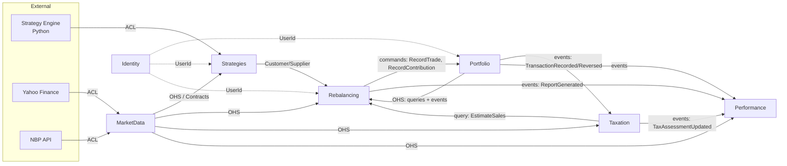
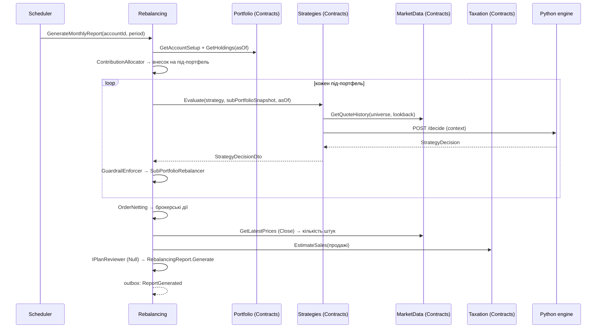

# План міграції: Investment Strategy Lab → .NET модулярний моноліт

> Статус: **ЧЕРНЕТКА НА ЗАТВЕРДЖЕННЯ**
> Дата: 2026-10-25
> Обсяг: повна специфікація архітектури (DDD), структура репозиторію, етапи міграції.

---

## 0. Зміст

1. [Мета й межі](#1-мета-й-межі)
2. [Зафіксовані рішення](#2-зафіксовані-рішення)
3. [Технологічний стек](#3-технологічний-стек)
4. [Єдина мова (Ubiquitous Language)](#4-єдина-мова-ubiquitous-language)
5. [Bounded Contexts і карта контекстів](#5-bounded-contexts-і-карта-контекстів)
6. [Специфікація контекстів](#6-специфікація-контекстів)
7. [Ключові наскрізні сценарії](#7-ключові-наскрізні-сценарії)
8. [Правила коду (C#)](#8-правила-коду-c)
9. [Модулярний моноліт → мікросервіси](#9-модулярний-моноліт--мікросервіси)
10. [Структура репозиторію і фолдерів](#10-структура-репозиторію-і-фолдерів)
11. [Frontend (Angular)](#11-frontend-angular)
12. [Strategy Engine (Python-сайдкар)](#12-strategy-engine-python-сайдкар)
13. [Тестування](#13-тестування)
14. [Етапи міграції](#14-етапи-міграції)
15. [Відкриті питання на затвердження](#15-відкриті-питання-на-затвердження)

---

## 1. Мета й межі

**Мета.** Перетворити поточний Python-інструмент (GitHub Actions + `positions.json` + HTML-звіти)
на веб-сервіс, де користувач:

- логіниться;
- налаштовує рахунок із **віртуальними під-портфелями**, кожен зі своєю стратегією та цільовою часткою;
- щомісяця отримує на дашборді **рапорт** — робочий документ із діями для ребалансування;
- відмічає в рапорті фактичне виконання (виконано / частково / пропущено, фактичні ціни, угоди поза планом);
- бачить на дашборді вартість, дохідність (TWR, XIRR), алокацію, план vs факт і оцінку **податку Белки**.

**Поза межами першої версії:** email/Telegram, AI-рецензент (лише порт), JSON-пайплайн і C#-стратегії
(лише порт), інтеграції з API брокерів, мультивалютні рахунки, крім EUR/USD із податком у PLN.

---

## 2. Зафіксовані рішення

| # | Рішення |
|---|---|
| D1 | Модулярний моноліт на .NET; кожен модуль — окремий bounded context, готовий до виділення в мікросервіс. |
| D2 | **Віртуальні під-портфелі** в межах одного брокерського рахунку. Комбінована стратегія = рахунок з N під-портфелями. |
| D3 | Цільові частки під-портфелів фіксовані; **внесок іде тому, хто найбільше відстає** (`FillUnderweight`). Альтернатива — `FixedSplit`. |
| D4 | Спільний порт `IStrategyEngine`. Реалізації: Python-сайдкар (зараз), JSON-пайплайн і C#-код (потім), AI (потім). |
| D5 | Стратегія видає **цілі, а не ордери**. Ордери рахує детермінований ребалансер у .NET. Guardrails перевіряються після будь-якої стратегії. |
| D6 | Ціни належать модулю `MarketData` (кеш у БД, нічне завантаження), а не стратегії. Провайдер за портом, спочатку yfinance через Python `/prices`. |
| D7 | Рапорт — робочий документ. **Ledger змінюється тільки фактичними відмітками**, не планом. Внесок — окрема дія в рапорті. |
| D8 | Податок рахується **на рівні рахунку** (FIFO), розподіляється на під-портфель-продавця. Розрахунок — чиста функція над історією. `ITaxPolicy` складається з блоків. |
| D9 | Графіки будуються зі щоденних знімків, які похідні від ledger-а. Зміни заднім числом інвалідують знімки від дати зміни. |
| D10 | AI-рецензент — порт `IPlanReviewer` + `NullPlanReviewer`; місце в рапорті й життєвому циклі зарезервоване. |
| D11 | Без пошти й Telegram на старті; сповіщення тільки в застосунку. |

---

## 3. Технологічний стек

### Backend
| Область | Вибір | Примітка |
|---|---|---|
| Runtime | **.NET 10 (LTS), C# 14** | extension members, `field`, null-conditional assignment, collection expressions, primary constructors |
| Solution | `.slnx`, Central Package Management (`Directory.Packages.props`) | |
| API | ASP.NET Core Minimal APIs, `MapGroup` на модуль, вбудований OpenAPI | Типізовані результати `TypedResults` |
| Messaging | **Wolverine** (MIT): in-process bus, EF Core outbox/inbox, scheduled messages | Пізніше той самий код працює через RabbitMQ / Azure Service Bus (див. §9) |
| ORM / БД | EF Core 10 + **PostgreSQL**; окрема схема і `DbContext` на модуль | named query filters для `OwnerId` |
| Фонові задачі | Wolverine scheduled/recurring messages (або Hangfire, див. §15) | нічні котирування, щомісячні рапорти, щотижневий ризик |
| Auth | ASP.NET Core Identity, cookie-автентифікація (BFF, same-origin) + Google login (опційно) | без JWT у localStorage |
| Оркестрація dev | **.NET Aspire** AppHost: Postgres, Python-сайдкар, Angular dev server | |
| Логи/телеметрія | OpenTelemetry через Aspire ServiceDefaults | |
| Тести | xUnit v3, Shouldly/AwesomeAssertions, Testcontainers, Verify (snapshot), ArchUnitNET | |

### Frontend
| Область | Вибір |
|---|---|
| Framework | **Angular 21+** (остання стабільна на старті): standalone, zoneless, signals |
| Дані | `httpResource` / `resource`, signal stores на фічу |
| Форми | Signal Forms (якщо стабільні на старті) або typed reactive forms |
| UI-кіт | Angular Material (див. §15) |
| Графіки | Apache ECharts (`ngx-echarts`) |
| API-клієнт | генерація з OpenAPI (`ng-openapi-gen` або orval) |
| Тести | Vitest, Playwright (e2e) |

### Strategy Engine
Python 3.12+, FastAPI, наявний код `finance_decisions` (scanner, risk, backtest), `uv`.

---

## 4. Єдина мова (Ubiquitous Language)

Код англійською, UI українською. Назви в коді відповідають бізнес-термінам **один до одного**.

| Українською (UI) | У коді | Контекст | Визначення |
|---|---|---|---|
| Рахунок | `InvestmentAccount` | Portfolio | Реальний брокерський рахунок користувача. |
| Під-портфель | `SubPortfolio` | Portfolio | Віртуальна частина рахунку, якою керує одна стратегія. |
| Цільова частка | `TargetShare` | Portfolio | Частка рахунку, яку має займати під-портфель. Сума часток = 100%. |
| Політика внесків | `ContributionPolicy` | Portfolio | Як щомісячний внесок ділиться між під-портфелями. |
| Обмеження | `Guardrails` | Portfolio | Жорсткі межі під-портфеля: макс. вага позиції, макс. turnover, дозволений універсум. |
| Операція | `Transaction` | Portfolio | Запис у журналі: угода, внесок, вивід, трансфер, податок, комісія, коригування. |
| Угода | `Trade` | Portfolio | Купівля або продаж інструмента за фактичною ціною. |
| Позиція | `Holding` | Portfolio | Кількість інструмента в під-портфелі (похідна з операцій). |
| Звірка | `Reconciliation` | Portfolio | Порівняння ledger-а з виписки брокера і коригування розбіжностей. |
| Інструмент | `Instrument` | MarketData | ETF, індекс, валютна пара. Ідентифікується за ISIN. |
| Котирування | `DailyQuote` | MarketData | Ціна закриття (`Close`) і скоригована ціна (`AdjustedClose`) за день. |
| Курс валюти | `FxRate` | MarketData | Курс NBP/ECB на дату. |
| Тип стратегії | `StrategyType` | Strategies | Алгоритм (наприклад, `etf-momentum`), реалізований рушієм. |
| Стратегія | `Strategy` | Strategies | Налаштований екземпляр типу: параметри, універсум. |
| Версія стратегії | `StrategyVersion` | Strategies | Незмінний знімок параметрів. Рапорт посилається на конкретну версію. |
| Рішення стратегії | `StrategyDecision` | Strategies | Цільові ваги, частка інвестування, сигнали ризику, обґрунтування. |
| Цільова вага | `TargetWeight` | Strategies | Частка інструмента в під-портфелі. |
| Сигнал ризику | `RiskSignal` | Strategies | Попередження або вихід по позиції (стоп, MA, просідання). |
| Обґрунтування | `Rationale` | Strategies | Чому стратегія вирішила саме так (метрики, фільтри). |
| Рапорт | `RebalancingReport` | Rebalancing | Робочий документ із діями на період. |
| Дія | `ReportAction` | Rebalancing | Один крок: внести, продати, купити, запаркувати, розпаркувати. |
| Виконання | `Fill` | Rebalancing | Фактична кількість, ціна, комісія, дата для дії. |
| Пропуск | `Skip` | Rebalancing | Свідома відмова від дії з причиною. |
| Неттінг | `OrderNetting` | Rebalancing | Згортання протилежних дій під-портфелів у одну брокерську угоду. |
| Рецензія | `PlanReview` | Rebalancing | (майбутнє) Оцінка плану AI-рецензентом. |
| Податкова політика | `TaxPolicy` | Taxation | Набір правил оподаткування (`PL-Belka`, `PL-IKE`). |
| Податковий лот | `TaxLot` | Taxation | Партія купівлі для FIFO. |
| Реалізація | `Realization` | Taxation | Зіставлення продажу з лотами: виручка, витрати, зиск. |
| Податкова оцінка | `TaxAssessment` | Taxation | Розрахунок податку за рік для рахунку. |
| Знімок вартості | `ValuationSnapshot` | Performance | Вартість, кеш, внески, індекс TWR на дату. |
| Тіньовий портфель | `ShadowPortfolio` | Performance | Сценарій «якби все за планом» (або альтернатива AI). |

---

## 5. Bounded Contexts і карта контекстів

| Контекст | Тип субдомену | Відповідальність |
|---|---|---|
| **Identity** | Generic | Користувачі, вхід, профіль (валюта відображення, мова). |
| **MarketData** | Supporting | Довідник інструментів, котирування, курси валют, якість даних. |
| **Strategies** | Core | Каталог типів, налаштовані стратегії та їхні версії, виклик рушіїв, стан стратегій. |
| **Portfolio** | Core | Рахунки, під-портфелі, цільові частки, журнал операцій, позиції, звірка. |
| **Rebalancing** | Core | Генерація рапортів (розподіл внеску, ребалансер, неттінг, guardrails), робота з рапортом. |
| **Taxation** | Supporting | Податкові політики, лоти, реалізації, річна оцінка, оцінка для плану. |
| **Performance** | Supporting | Щоденні знімки, TWR/XIRR, просідання, тіньові портфелі. |

### Карта контекстів



**Правила напрямку:**
- `Portfolio` — upstream для `Rebalancing`. Рапорти про портфель знають, а портфель про рапорти ні. Rebalancing надсилає **команди** `RecordTrade` / `RecordContribution` з посиланням `SourceReference = ReportActionId`. Portfolio відповідає подіями `TransactionRecorded` або `TransactionRejected`.
- `MarketData` — Open Host Service для всіх. Ніхто, крім нього, не ходить до провайдерів даних.
- `Taxation` і `Performance` тримають **власні копії** потрібних даних (операції, плани), отримані з подій. Це готує їх до виділення в окремі сервіси.
- Зовнішні системи (Python, Yahoo, NBP) підключаються тільки через Anti-Corruption Layer в `Infrastructure` відповідного модуля.

---

## 6. Специфікація контекстів

Позначення: **AR** — aggregate root, **E** — entity, **VO** — value object, **DS** — domain service,
**DE** — domain event (всередині модуля), **IE** — integration event (у `Contracts`), **P** — порт (інтерфейс в Application, реалізація в Infrastructure).

### 6.1 SharedKernel (спільне ядро — мінімальне)

Лише стабільні концепції, однакові в усіх контекстах:

| Тип | Вид | Примітка |
|---|---|---|
| `Money` | VO | `Amount` (decimal) + `Currency`. Арифметика тільки в межах однієї валюти. |
| `Currency` | VO | ISO 4217 (`EUR`, `USD`, `PLN`). |
| `Percentage` | VO | Частка 0..1 (з можливістю від'ємних для дохідності: `SignedPercentage`). |
| `Quantity` | VO | Кількість штук, підтримка дробових; ≥ 0. |
| `Price` | VO | `Money` за одиницю; > 0. |
| `Isin` | VO | Валідація контрольної суми ISIN. |
| `YearMonth` | VO | Період рапорту. |
| `UserId` | VO (strongly typed id) | Власник даних. |
| `Entity<TId>`, `AggregateRoot<TId>`, `IDomainEvent` | будівельні блоки | |
| `Result`, `Result<T>`, `Error` | будівельні блоки | Помилки домену без винятків. |

> Ідентифікатори конкретних агрегатів (`AccountId`, `ReportId`…) живуть у своїх модулях, а не в SharedKernel. У `Contracts` вони передаються як `Guid`.

### 6.2 Identity

| Елемент | Вид | Опис |
|---|---|---|
| `User` | AR (ASP.NET Identity) | Email, пароль/зовнішній логін. |
| `UserProfile` | AR | `DisplayCurrency`, `Locale`, `TimeZone`. |
| `UserRegistered` | IE | Інші модулі можуть створити дефолтні дані. |

Ізоляція даних: кожен агрегат в інших модулях має `OwnerId: UserId`; EF named query filter `"Owner"` фільтрує за поточним користувачем.

### 6.3 MarketData

**Агрегати**

| Елемент | Вид | Інваріанти / поведінка |
|---|---|---|
| `Instrument` | AR | `InstrumentId`, `Isin?` (обов'язковий для ETF), `Name`, `Exchange`, `TradingCurrency`, `InstrumentKind` (Etf, Index, FxPair), `Group` (напр. «S&P 500»), `IsAccumulating?`. Метод `AssignProviderSymbol(provider, symbol)` — один символ на провайдера. |
| `ProviderSymbol` | VO | `QuoteProvider` + `Symbol` (`yfinance:SXR8.DE`). |
| `QuoteCorrection` | AR | Ручне виправлення ціни з причиною й автором; аудит. |

**Дані (не агрегати — часові ряди великого обсягу)**

| Елемент | Вид | Опис |
|---|---|---|
| `DailyQuote` | VO / рядок часового ряду | `InstrumentId`, `TradingDate`, `Close`, `AdjustedClose`, `Source`, `FetchedAt`, `QualityFlags`. |
| `FxRate` | VO / рядок | `Source` (NBP, ECB), `Base`, `Quote`, `EffectiveDate`, `Rate`, `TableNumber?`. |
| `QualityFlags` | VO (flags) | `Stale`, `Gap`, `Spike`, `Corrected`. |

**Доменні сервіси:** `QuoteQualityInspector` (позначає застарілі дані, пропуски, стрибки), `FxRateResolver` («останній робочий день перед датою» з урахуванням свят).

**Порти:** `IQuoteProvider` (→ `YFinanceQuoteProvider` через Python `/prices`, пізніше `EodhdQuoteProvider`), `IFxRateProvider` (→ `NbpFxRateProvider`, `EcbFxRateProvider`).

**Use cases (Application, по фічах):**
`RegisterInstrument`, `AssignProviderSymbol`, `IngestDailyQuotes` (нічна задача), `CorrectQuote`, `IngestFxRates`, `GetQuoteHistory` (query), `GetLatestPrices` (query), `GetFxRate` (query).

**Contracts:** `IMarketDataQueries` (`GetQuoteHistory`, `GetLatestPrices`, `GetFxRate`, `GetInstruments`); IE: `DailyQuotesIngested(date, instrumentIds)`, `QuoteCorrected(instrumentId, date)`.

### 6.4 Strategies

**Агрегати**

| Елемент | Вид | Інваріанти / поведінка |
|---|---|---|
| `Strategy` | AR | `StrategyId`, `OwnerId`, `Name`, `StrategyTypeCode`, `Universe` (список `InstrumentId`), `RebalanceFrequency`, список `StrategyVersion`. `Reconfigure(parameters, universe)` створює **нову версію**; старі версії незмінні. Параметри валідуються JSON Schema типу. Універсум не може бути порожнім. |
| `StrategyVersion` | E | `VersionNumber`, `Parameters` (VO `StrategyParameters`, JSON), `UniverseSnapshot`, `CreatedAt`. |
| `StrategyState` | AR | Стан між запусками для стратегій зі станом; ключ `(StrategyId, SubPortfolioId)`. |

**Value objects:** `StrategyTypeCode`, `StrategyParameters`, `RebalanceFrequency` (Monthly, Weekly), `StrategyDecision`, `TargetWeight` (`InstrumentId` + `Percentage`), `InvestFraction`, `RiskSignal` (`InstrumentId`, `RiskSignalKind`: Warn/Exit, `Reason`, `ExitPrice?`), `Rationale` (структуровані метрики + текст), `InstrumentScore` (метрики для таблиці «чому так»).

**Каталог типів:** `StrategyTypeDescriptor` (код, назва, опис, JSON Schema параметрів, рушій, підтримка стану). Каталог наповнюється з коду та з `/schema` Python-сайдкара.

**Порти:**
- `IStrategyEngine` — `Task<StrategyDecision> DecideAsync(StrategyEvaluationContext ctx, CancellationToken ct)`. Реалізації: `PythonStrategyEngine` (HTTP), пізніше `PipelineStrategyEngine`, `CodeStrategyEngine`, `AiStrategyEngine`.
- `IStrategyEngineResolver` — вибір рушія за `StrategyTypeCode`.

**`StrategyEvaluationContext`** (серіалізований знімок, без доступу назовні): `AsOf`, `SubPortfolioSnapshot` (позиції, лоти, кеш, внесок), `MarketSeries` (котирування `AdjustedClose`/`Close` до `AsOf`, з прапорцями якості, VIX), `Parameters`, `State?`.

**Use cases:** `CreateStrategy`, `ReconfigureStrategy`, `ArchiveStrategy`, `EvaluateStrategy` (будує контекст, викликає рушій, зберігає новий стан, повертає рішення), `EvaluateRisk` (щотижневий ризик), `GetStrategyCatalog`, `GetStrategy`.

**Contracts:** `IStrategyEvaluation.EvaluateAsync(strategyId, version, subPortfolioSnapshot, asOf)` → `StrategyDecisionDto`; IE: `StrategyReconfigured`.

### 6.5 Portfolio

**Агрегати**

| Елемент | Вид | Інваріанти / поведінка |
|---|---|---|
| `InvestmentAccount` | AR | `AccountId`, `OwnerId`, `Name`, `Broker`, `BaseCurrency`, `TaxPolicyCode`, `ContributionPolicy`, `SubPortfolios`. **Сума `TargetShare` активних під-портфелів = 100%.** Методи: `AddSubPortfolio`, `ChangeTargetShares` (атомарно для всіх), `AssignStrategy`, `RetireSubPortfolio`, `ChangeContributionPolicy`. |
| `SubPortfolio` | E | `SubPortfolioId`, `Name`, `TargetShare`, `StrategyRef` (`StrategyId` + політика версії: остання або закріплена), `CashInstrumentId?` (ETF для паркування, напр. XEON), `Guardrails`, `Status`. |
| `Transaction` | AR | Незмінний запис журналу. `TransactionId`, `AccountId`, `TransactionKind`, `OccurredOn`, `Source` (`ReportAction(id)`, `Manual`, `Reconciliation`, `Import`), `ReversalOf?`. Варіанти тіла: `TradeDetails` (інструмент, `TradeSide`, `Quantity`, `Price`, `Fee`, розподіл по під-портфелях), `CashMovementDetails` (внесок, вивід, комісія, сплата податку, дивіденд), `InternalTransferDetails` (з під-портфеля в під-портфель: інструмент або кеш). Метод `Reverse(reason)` створює сторно-операцію, оригінал не змінюється. |
| `Reconciliation` | AR | Виписка брокера на дату (позиції, кеш), обчислені розбіжності, рішення по кожній (`AcceptAsAdjustment(subPortfolioId)`, `Ignore`). Прийнята розбіжність породжує `Transaction` з `Source = Reconciliation`. |

**Value objects:** `TargetShare`, `ContributionPolicy` (`FillUnderweight` | `FixedSplit`, плюс `DriftBand` для пропозиції внутрішнього трансферу), `Guardrails` (`MaxPositionWeight`, `MaxMonthlyTurnover`, `AllowLeverage=false`), `Allocation` (`SubPortfolioId` + `Quantity`/`Money`), `TradeSide`, `TransactionSource`, `Broker`.

**Read model (проєкція в тому ж модулі, оновлюється в тій самій транзакції):**
`Holdings` — на під-портфель: позиції (`Quantity`, віртуальна середня вартість, віртуальні лоти) + кеш у валюті рахунку.

**Доменні сервіси:**
- `TransactionRecorder` — перевіряє операцію щодо поточних `Holdings` (не можна продати більше, ніж є в під-портфелі; розподіл має сумуватися до кількості угоди; не можна купити на більше, ніж кеш, якщо внесок не зафіксовано — попередження, а не помилка) і записує її.
- `TradeAllocator` — розподіляє брокерську угоду між під-портфелями пропорційно плановим частинам (якщо розподіл не задано явно).

**Use cases:** `OpenAccount`, `AddSubPortfolio`, `ChangeTargetShares`, `AssignStrategy`, `ChangeContributionPolicy`, `RecordTrade`, `RecordContribution`, `RecordCashMovement`, `RecordInternalTransfer`, `ReverseTransaction`, `StartReconciliation`, `ResolveDifference`, `ImportPositions` (одноразовий імпорт `positions.json`), queries: `GetAccount`, `GetHoldings`, `GetTransactions`.

**Contracts:**
- команди: `RecordTrade`, `RecordContribution` (з `SourceReference`, ідемпотентність за ним);
- queries: `IPortfolioQueries` (`GetAccountSetup`, `GetHoldings(asOf)`, `GetSubPortfolioSnapshot`);
- IE: `TransactionRecorded`, `TransactionReversed`, `TransactionRejected(sourceReference, reason)`, `TargetSharesChanged`, `SubPortfolioAdded`.

### 6.6 Rebalancing

**Агрегат `RebalancingReport` (AR)**

| Поле | Тип |
|---|---|
| `ReportId` | strongly typed id |
| `AccountId`, `OwnerId` | |
| `Period` | `YearMonth` |
| `Kind` | `ReportKind`: `Monthly`, `Recalculation`, `RiskReview` (щотижневий) |
| `Status` | `ReportStatus`: `New`, `InProgress`, `Closed`, `Superseded` |
| `MarketAsOf` | дата котирувань, на яких рахувався план |
| `ContributionPlan` | VO: сума, розподіл по під-портфелях, обрана політика |
| `Sections` | E `ReportSection` на під-портфель: `StrategyRef` + версія, знімок `StrategyDecision`, `Rationale`, алокація до/після |
| `Actions` | E `ReportAction` (див. нижче) — **рівень брокера, після неттінгу** |
| `TaxEstimate` | VO: оцінка податку від продажів у плані |
| `Review` | VO `PlanReview?` (зарезервовано під AI) |
| `Warnings` | VO (якість даних, guardrails, які обрізали ціль) |
| `SupersededBy` | `ReportId?` |

**Сутність `ReportAction` (E)**

| Поле | Тип |
|---|---|
| `ReportActionId` | |
| `Kind` | `ActionKind`: `Contribute`, `Sell`, `Buy`, `Park`, `Unpark` |
| `Instrument` | `InstrumentId?` (немає для `Contribute`) |
| `PlannedQuantity`, `PlannedPrice`, `PlannedAmount` | `Quantity`, `Price`, `Money` |
| `PlannedAllocations` | список `Allocation` по під-портфелях (розбивка неттінгу) |
| `Reason` | текст із правила (exit, trim, top-up…) |
| `TaxEstimate` | VO для продажів |
| `Status` | `ActionStatus`: `Pending`, `Executed`, `PartiallyExecuted`, `Skipped` |
| `Fills` | список VO `Fill` (`Quantity`, `Price`, `Fee`, `ExecutedOn`, `TransactionId?`) |
| `SkipReason` | VO `SkipReason?` |

**Поведінка й інваріанти**

| Метод | Правило |
|---|---|
| `MarkExecuted(Fill fill)` | Тільки в `New`/`InProgress`. Ціна й кількість за замовчуванням планові, але змінні. Статус дії → `Executed`. Подія `ActionFillRecorded`. |
| `RecordPartialFill(Fill fill, string? note)` | Сума кількостей < планової (з толерантністю на округлення). Можна викликати кілька разів. Статус → `PartiallyExecuted`. |
| `Skip(SkipReason reason)` | Тільки `Pending`. |
| `UndoMark(ReportActionId)` | Повертає дію в `Pending`; подія `ActionMarkUndone` → Portfolio сторнує пов'язані операції. |
| `ApplyTransactionResult(...)` | Прив'язує `TransactionId` до `Fill` або відкочує відмітку при `TransactionRejected` (з повідомленням). |
| `Close(UnmarkedActionsPolicy)` | Невідмічені дії стають `Skipped` («закрито без відмітки»). Статус → `Closed`. |
| `SupersedeBy(ReportId)` | Для перерахунку або нового місячного рапорту, якщо попередній відкритий. |
| Статус рапорту | `New` → `InProgress` при першій відмітці → `Closed` автоматично, коли всі дії мають фінальний статус. |

**Доменні сервіси (планування — чисті функції, перенесення логіки `plan.py`)**

| Сервіс | Відповідальність |
|---|---|
| `ContributionAllocator` | Розподіл внеску між під-портфелями (`FillUnderweight`, `FixedSplit`), пропозиція внутрішнього трансферу при виході за `DriftBand`. |
| `SubPortfolioRebalancer` | Рішення стратегії + позиції + кеш + внесок → ордери під-портфеля. Правила з `plan.py`: вихід із невибраних, invest fraction у слабкому ринку, `1/top_n` на позицію, top-up, trim тільки в плюсі й понад `TrimBand`, `MinTrade`, дробові акції, park/unpark у cash ETF. |
| `GuardrailEnforcer` | Обрізає цілі, які порушують `Guardrails`; додає `Warnings`. |
| `OrderNetting` | Згортає ордери під-портфелів у брокерські дії + внутрішні трансфери. |
| `RebalancingPolicy` | VO з параметрами: `MinTrade`, `TrimBand`, `AllowFractionalShares`, `TaxAwareTrim?`. |

**Порти:** `IPlanReviewer` (→ `NullPlanReviewer`).

**Use cases:** `GenerateMonthlyReport` (задача за розкладом і кнопка), `GenerateRiskReview` (щотижнева задача), `RecalculateReport`, `MarkActionExecuted`, `RecordPartialFill`, `SkipAction`, `UndoActionMark`, `CloseReport`, `RecordOffPlanTrade` (проксі в Portfolio з прив'язкою до відкритого рапорту), queries: `GetReport`, `ListReports`, `GetOpenActionsCount`.

**Contracts:** IE `ReportGenerated` (з плановими діями — для тіньового портфеля), `ReportClosed`, `ReportSuperseded`.

### 6.7 Taxation

**Агрегати**

| Елемент | Вид | Інваріанти / поведінка |
|---|---|---|
| `TaxAssessment` | AR | Ключ `(AccountId, TaxYear)`. `PolicyCode`, `PolicyVersion`, `InputHash`, `ComputedAt`, `Lots`, `Realizations`, `Summary`. `Recompute(TaxLedger, ITaxPolicy)` — повністю перебудовує результат; якщо `InputHash` не змінився, нічого не робить. |
| `TaxLot` | E | `InstrumentId`, `AcquiredOn`, `RemainingQuantity`, `CostInTaxCurrency`, `FxRate`, `FxRateDate`, `AcquisitionFee`, `SourceTransactionId`. |
| `Realization` | E | `SaleTransactionId`, зіставлені лоти (`LotId`, `Quantity`), `Proceeds`, `Cost`, `Gain`, `AttributedSubPortfolioId`. |
| `TaxLedger` | AR | Власна копія оподатковуваних операцій рахунку (з подій Portfolio). |
| `LossCarryforward` | AR | Збитки минулих років, введені користувачем: рік, сума, використано. |

**Value objects:** `TaxYear`, `TaxPolicyCode`, `TaxYearSummary` (`Revenue`, `Costs`, `Gain`, `CarryforwardUsed`, `TaxBase`, `TaxDue`), `TaxEstimate` (`EstimatedGain`, `EstimatedTax`, `FxRateUsed`, `IsFinal`).

**Політика як композиція (DS):**

```
ITaxPolicy
 ├─ ILotMatcher            FIFO | LIFO | HIFO | AverageCost | UkSection104Pool
 ├─ IFxConversionRule      NbpPreviousBusinessDay(TradeDate|SettlementDate) | Ecb | None
 ├─ ITaxRateSchedule       Flat(0.19) | ...
 ├─ INettingRule           AnnualNetting | PerTransaction
 ├─ ILossCarryforwardRule  Pl5Years50Percent | Unlimited | None
 └─ IRoundingRule          PlWholeZloty | None

BelkaTaxPolicy  = FIFO + NbpPreviousBusinessDay + Flat(19%) + AnnualNetting + Pl5Years50Percent + PlWholeZloty
NoTaxPolicy     = IKE / IKZE
```

**Use cases:** `RecomputeAssessment` (на `TransactionRecorded/Reversed`, `QuoteCorrected` не впливає, `FxRate` — так), `EstimateSales` (query для плану), `RecordLossCarryforward`, `GetAssessment`.

**Contracts:** `ITaxEstimator.EstimateSalesAsync(accountId, proposedSales, asOf)`; IE `TaxAssessmentUpdated(accountId, year)`.

> ⚠️ Розрахунок — оцінка. Дату курсу (дата угоди vs дата розрахунку) зроблено налаштуванням політики. Авторитетні — PIT-8C брокера / податковий консультант. У UI постійний дисклеймер.

### 6.8 Performance

**Агрегати / моделі**

| Елемент | Вид | Опис |
|---|---|---|
| `ShadowPortfolio` | AR | `(AccountId, Scenario)`: `FullPlan` або `Alternative(reviewId)`. Застосовує планові дії з `ReportGenerated` за плановими цінами. |
| `PerformanceLedger` | AR | Власна копія операцій (з подій Portfolio) і цільових часток. |
| `RecalculationMarker` | AR | `(AccountId, DirtyFrom)`; зсувається тільки назад. |
| `ValuationSnapshot` | read model | `(AccountId, SubPortfolioId?, Date)`: `MarketValue`, `Cash`, `NetContributions`, `TwrIndex`, `Unrealized`, `RealizedYtd`, `TaxAccrued`. |
| `PositionSnapshot` | read model | Позиція на дату: кількість, ціна, вартість, вага, цільова вага. |

**Доменні сервіси:** `ValuationCalculator`, `TwrCalculator` (ланцюжкові денні дохідності, потоки на початок дня), `XirrCalculator`, `DrawdownCalculator`, `ShadowPortfolioSimulator`.

**Use cases:** `RebuildSnapshots(accountId, from)` (фонова задача), `MarkDirty` (на події), `GetDashboard`, `GetValueSeries`, `GetPerformance(period)`, `GetPlanVsActual`, `GetAllocation`.

**Contracts:** немає вихідних команд; споживає `TransactionRecorded/Reversed`, `ReportGenerated`, `DailyQuotesIngested`, `QuoteCorrected`, `TaxAssessmentUpdated`, `TargetSharesChanged`.

---

## 7. Ключові наскрізні сценарії

### 7.1 Щомісячний рапорт



### 7.2 Відмітка виконання

1. UI → `POST /reports/{id}/actions/{actionId}/fills` (кількість, ціна, комісія, дата).
2. `RebalancingReport.MarkExecuted` → DE `ActionFillRecorded` → outbox → команда `RecordTrade` в Portfolio (`SourceReference = actionId:fillNo`).
3. Portfolio: `TransactionRecorder` → `Transaction` + оновлення `Holdings` → IE `TransactionRecorded`.
4. Rebalancing: `ApplyTransactionResult` прив'язує `TransactionId`. При `TransactionRejected` відмітка відкочується, і користувач бачить причину.
5. Taxation: `RecomputeAssessment` → `TaxAssessmentUpdated`.
6. Performance: `MarkDirty(from = executedOn)` → `RebuildSnapshots`.
7. UI оновлюється (polling `httpResource` або SSE — див. §15).

Ідемпотентність: Wolverine inbox + унікальний індекс на `Transaction.SourceReference`.

### 7.3 Сторно (скасування відмітки)
`UndoActionMark` → DE `ActionMarkUndone` → `ReverseTransaction` у Portfolio → `TransactionReversed` → Taxation і Performance перераховують.

### 7.4 Щотижневий ризик
Scheduler → `GenerateRiskReview` → `Strategies.EvaluateRisk` по кожному під-портфелю → рапорт `Kind = RiskReview` з діями `Sell` тільки для сигналів `Exit` і попередженнями для `Warn`.

---

## 8. Правила коду (C#)

### 8.1 Загальні
- File-scoped namespaces, `global using` на проєкт, `nullable enable`, `TreatWarningsAsErrors`.
- Назви класів і методів — бізнес-мовою з §4. Без `Manager`, `Helper`, `Util`, `Data`.
- Агрегат змінюється тільки через методи з бізнес-назвами (`MarkExecuted`, `ChangeTargetShares`), без публічних сеттерів.
- Помилки домену — `Result`/`Error`, не винятки. Винятки — тільки для порушення програмних контрактів.
- Один агрегат на транзакцію; між агрегатами — доменні події, між модулями — integration events / контракти.
- Primary constructors — для сервісів, handler-ів, endpoint-ів. **Не** для VO й агрегатів (там валідація у фабриках).

### 8.2 Value objects: `Of` замість `new`

```csharp
namespace InvestmentLab.SharedKernel;

public sealed record Money
{
    public decimal Amount { get; }
    public Currency Currency { get; }

    private Money(decimal amount, Currency currency) => (Amount, Currency) = (amount, currency);

    public static Money Of(decimal amount, Currency currency) => new(decimal.Round(amount, 2), currency);
    public static Money Zero(Currency currency) => new(0m, currency);

    public Money Add(Money other) => Of(Amount + EnsureSameCurrency(other).Amount, Currency);
    public Money Subtract(Money other) => Of(Amount - EnsureSameCurrency(other).Amount, Currency);
    public Money Multiply(decimal factor) => Of(Amount * factor, Currency);

    public static Money operator +(Money left, Money right) => left.Add(right);
    public static Money operator -(Money left, Money right) => left.Subtract(right);

    private Money EnsureSameCurrency(Money other) =>
        other.Currency == Currency ? other : throw new CurrencyMismatchException(Currency, other.Currency);
}
```

Правила:
- конструктор `private`, властивості тільки `get` (тоді `with` не обійде валідацію);
- `Of(...)` — головна фабрика; для вводу користувача — `TryOf(...)` → `Result<T>`;
- додаткові фабрики з бізнес-назвами: `Money.Zero`, `Percentage.FromPercent(19)`, `Quantity.None`.

```csharp
public sealed record Percentage
{
    public decimal Value { get; }

    private Percentage(decimal value) => Value = value;

    public static Percentage Of(decimal fraction) =>
        fraction is >= 0m and <= 1m ? new(fraction) : throw new ArgumentOutOfRangeException(nameof(fraction));

    public static Result<Percentage> TryOf(decimal fraction) =>
        fraction is >= 0m and <= 1m ? new Percentage(fraction) : PercentageErrors.OutOfRange(fraction);

    public static Percentage FromPercent(decimal percent) => Of(percent / 100m);
}
```

### 8.3 Strongly typed ids

```csharp
public readonly record struct ReportId
{
    public Guid Value { get; }
    private ReportId(Guid value) => Value = value;

    public static ReportId New() => new(Guid.CreateVersion7());
    public static ReportId Of(Guid value) =>
        value != Guid.Empty ? new(value) : throw new ArgumentException("Empty report id", nameof(value));
}
```

### 8.4 Агрегат (приклад читається як бізнес-правило)

```csharp
public sealed class RebalancingReport : AggregateRoot<ReportId>
{
    private readonly List<ReportAction> _actions = [];

    public AccountId AccountId { get; }
    public YearMonth Period { get; }
    public ReportStatus Status { get; private set; }
    public IReadOnlyList<ReportAction> Actions => _actions;

    public Result RecordPartialFill(ReportActionId actionId, Fill fill, string? note)
    {
        if (!IsOpenForMarking)
            return ReportErrors.ReportIsNotOpen(Id, Status);

        if (FindAction(actionId) is not { } action)
            return ReportErrors.ActionNotFound(actionId);

        var result = action.RecordPartialFill(fill, note);
        if (result.IsFailure)
            return result;

        StartWorkIfNew();
        Raise(new ActionFillRecorded(Id, actionId, fill));
        CloseWhenAllActionsResolved();
        return Result.Success();
    }

    private bool IsOpenForMarking => Status is ReportStatus.New or ReportStatus.InProgress;
    // ...
}
```

### 8.5 Можливості C# 14, які використовуємо

| Можливість | Де |
|---|---|
| `field` у властивостях | валідація в сутностях без ручних backing fields: `public string Name { get; private set => field = Guard.NotBlank(value); }` |
| extension members (`extension(...)` блоки) | доменні розширення для колекцій VO: `extension(IEnumerable<Money> amounts) { public Money Total(Currency c) => ... }`; extension-властивості для DTO-мапінгу |
| null-conditional assignment | `report.Review?.Attach(...)`, `entity?.Prop = value` в мапінгу |
| collection expressions | `List<ReportAction> _actions = [];`, `[..sells, ..buys]` |
| primary constructors | handler-и, endpoint-и, сервіси інфраструктури |
| list/property patterns | правила ребалансера (`order is { Kind: ActionKind.Sell, Amount.Amount: < 25m }`) |
| `required` + `init` | тільки DTO та контракти, не домен |
| `Guid.CreateVersion7()` | сортовані ідентифікатори |

### 8.6 Vertical slice (use case)

Кожен use case — окрема папка: команда/запит, handler, валідатор, endpoint, DTO.

```csharp
// Application/Reports/RecordPartialFill/RecordPartialFillCommand.cs
public sealed record RecordPartialFillCommand(
    Guid ReportId, Guid ActionId, decimal Quantity, decimal Price, decimal Fee, DateOnly ExecutedOn, string? Note);

// Application/Reports/RecordPartialFill/RecordPartialFillHandler.cs
public sealed class RecordPartialFillHandler(IReportRepository reports, TimeProvider clock)
{
    public async Task<Result> Handle(RecordPartialFillCommand command, CancellationToken ct)
    {
        if (await reports.FindAsync(ReportId.Of(command.ReportId), ct) is not { } report)
            return ReportErrors.NotFound(command.ReportId);

        var fill = Fill.Of(Quantity.Of(command.Quantity), Price.Of(command.Price, report.Currency),
                           Money.Of(command.Fee, report.Currency), command.ExecutedOn);

        return report.RecordPartialFill(ReportActionId.Of(command.ActionId), fill, command.Note);
        // збереження + outbox — через Wolverine transactional middleware
    }
}

// Api/Reports/RecordPartialFillEndpoint.cs
internal static class RecordPartialFillEndpoint
{
    public static RouteGroupBuilder MapRecordPartialFill(this RouteGroupBuilder group)
    {
        group.MapPost("/{reportId:guid}/actions/{actionId:guid}/partial-fills", async (
                Guid reportId, Guid actionId, PartialFillRequest body, IMessageBus bus, CancellationToken ct) =>
            (await bus.InvokeAsync<Result>(body.ToCommand(reportId, actionId), ct)).ToHttpResult())
            .WithName("RecordPartialFill");
        return group;
    }
}
```

---

## 9. Модулярний моноліт → мікросервіси

Правила, які дозволять виділити будь-який модуль без переписування домену:

1. **Модуль = проєкт `InvestmentLab.<Module>` + проєкт `InvestmentLab.<Module>.Contracts`.** Інші модулі посилаються **тільки** на `Contracts`. Перевіряється ArchUnitNET у CI.
2. `Contracts` містить тільки: integration events, команди між модулями, інтерфейси запитів (`I<Module>Queries`) і DTO з примітивами (`Guid`, `decimal`, `string`, `DateOnly`). Ніяких доменних типів.
3. **Своя схема БД** (`marketdata`, `strategies`, `portfolio`, `rebalancing`, `taxation`, `performance`, `identity`) і свій `DbContext`. Без FK між схемами, без JOIN-ів між модулями.
4. Асинхронна взаємодія — через **outbox/inbox Wolverine**. Сьогодні транспорт in-process (через Postgres-backed durable queues), завтра — RabbitMQ без зміни handler-ів.
5. Синхронні запити між модулями (`IMarketDataQueries`, `IPortfolioQueries`, `ITaxEstimator`, `IStrategyEvaluation`) — інтерфейси в `Contracts`. Сьогодні — in-process реалізація, завтра — HTTP/gRPC-клієнт з тим самим інтерфейсом.
6. Модулі, яким потрібні чужі дані для своїх розрахунків (Taxation, Performance), **тримають копії** з подій, а не питають щоразу.
7. Кожен модуль реєструється через `IModule` (`AddServices`, `MapEndpoints`, `ConfigureMessaging`). Host нічого не знає про внутрішність модулів.
8. Ідемпотентні споживачі (ключ — `SourceReference`/id повідомлення).
9. Кандидати на виділення першими: `MarketData` (нічне завантаження, інше навантаження) і `Strategies` (поруч із Python-рушієм).

---

## 10. Структура репозиторію і фолдерів

### 10.1 Корінь репозиторію

```text
investment-strategy-lab/
├── backend/                        # .NET модулярний моноліт
├── frontend/                       # Angular
├── strategy-engine/                # Python: поточний finance_decisions + FastAPI
├── docs/
│   ├── architecture/
│   │   ├── migration-plan.md       # цей документ
│   │   └── adr/                    # ADR-0001-modular-monolith.md, ...
│   └── domain/
│       └── glossary.md
├── .github/workflows/
│   ├── backend.yml
│   ├── frontend.yml
│   ├── strategy-engine.yml
│   └── (legacy) monthly_scanner.yml, weekly_risk_monitor.yml — до кінця паралельного запуску
└── README.md
```

### 10.2 Backend

```text
backend/
├── InvestmentLab.slnx
├── global.json
├── Directory.Build.props            # net10.0, LangVersion, Nullable, TreatWarningsAsErrors
├── Directory.Packages.props         # Central Package Management
├── .editorconfig
├── src/
│   ├── Hosts/
│   │   ├── InvestmentLab.Api/                       # composition root
│   │   │   ├── Program.cs
│   │   │   ├── Modules.cs                           # реєстрація всіх IModule
│   │   │   ├── Auth/
│   │   │   └── appsettings*.json
│   │   ├── InvestmentLab.AppHost/                   # .NET Aspire: Postgres, Api, strategy-engine, frontend
│   │   └── InvestmentLab.ServiceDefaults/           # OpenTelemetry, health checks, resilience
│   │
│   ├── BuildingBlocks/
│   │   ├── InvestmentLab.SharedKernel/              # Money, Currency, Percentage, Quantity, Price, Isin, YearMonth,
│   │   │   ├── Domain/                              #   Entity, AggregateRoot, IDomainEvent
│   │   │   ├── Money/
│   │   │   ├── Time/
│   │   │   └── Results/                             #   Result, Result<T>, Error
│   │   └── InvestmentLab.BuildingBlocks/            # IModule, EF base (ModuleDbContext, конвертери VO),
│   │       ├── Modules/                             #   outbox-конфіг, OwnerId-фільтр, Result→HTTP
│   │       ├── Persistence/
│   │       ├── Messaging/
│   │       └── Http/
│   │
│   └── Modules/
│       ├── Identity/
│       │   ├── InvestmentLab.Identity/
│       │   └── InvestmentLab.Identity.Contracts/
│       ├── MarketData/
│       │   ├── InvestmentLab.MarketData/
│       │   └── InvestmentLab.MarketData.Contracts/
│       ├── Strategies/
│       │   ├── InvestmentLab.Strategies/
│       │   └── InvestmentLab.Strategies.Contracts/
│       ├── Portfolio/
│       │   ├── InvestmentLab.Portfolio/
│       │   └── InvestmentLab.Portfolio.Contracts/
│       ├── Rebalancing/
│       │   ├── InvestmentLab.Rebalancing/
│       │   └── InvestmentLab.Rebalancing.Contracts/
│       ├── Taxation/
│       │   ├── InvestmentLab.Taxation/
│       │   └── InvestmentLab.Taxation.Contracts/
│       └── Performance/
│           ├── InvestmentLab.Performance/
│           └── InvestmentLab.Performance.Contracts/
│
└── tests/
    ├── Modules/
    │   ├── InvestmentLab.MarketData.Tests/
    │   ├── InvestmentLab.Strategies.Tests/
    │   ├── InvestmentLab.Portfolio.Tests/
    │   ├── InvestmentLab.Rebalancing.Tests/
    │   ├── InvestmentLab.Taxation.Tests/
    │   └── InvestmentLab.Performance.Tests/
    ├── InvestmentLab.ArchitectureTests/             # правила залежностей між модулями та шарами
    ├── InvestmentLab.IntegrationTests/              # Testcontainers Postgres + strategy-engine
    └── InvestmentLab.GoldenTests/                   # .NET ребалансер vs Python plan.py на фікстурах
        └── Fixtures/
```

### 10.3 Всередині модуля: feature-first + Domain / Application / Infrastructure

Приклад — **Rebalancing** (найбагатший модуль). Шари — це **папки в одному проєкті**; напрямок залежностей
`Api → Application → Domain`, `Infrastructure → Application/Domain` перевіряється ArchUnitNET.

```text
InvestmentLab.Rebalancing/
├── Domain/
│   ├── Reports/                                   # агрегат RebalancingReport
│   │   ├── RebalancingReport.cs                   # AR
│   │   ├── ReportAction.cs                        # E
│   │   ├── ReportSection.cs                       # E
│   │   ├── ReportId.cs
│   │   ├── ReportActionId.cs
│   │   ├── ReportStatus.cs
│   │   ├── ReportKind.cs
│   │   ├── ActionKind.cs
│   │   ├── ActionStatus.cs
│   │   ├── Fill.cs                                # VO
│   │   ├── SkipReason.cs                          # VO
│   │   ├── ContributionPlan.cs                    # VO
│   │   ├── ReportErrors.cs
│   │   ├── Events/
│   │   │   ├── ReportGenerated.cs
│   │   │   ├── ActionFillRecorded.cs
│   │   │   ├── ActionSkipped.cs
│   │   │   ├── ActionMarkUndone.cs
│   │   │   └── ReportClosed.cs
│   │   └── IReportRepository.cs
│   ├── Planning/                                  # доменні сервіси планування (чисті функції)
│   │   ├── ContributionAllocator.cs
│   │   ├── SubPortfolioRebalancer.cs
│   │   ├── GuardrailEnforcer.cs
│   │   ├── OrderNetting.cs
│   │   ├── RebalancingPolicy.cs                   # VO
│   │   ├── PlannedOrder.cs                        # VO
│   │   └── SubPortfolioPosition.cs                # VO (вхід ребалансера)
│   └── Reviews/
│       ├── PlanReview.cs                          # VO (зарезервовано)
│       └── ReviewFinding.cs                       # VO
│
├── Application/
│   ├── Reports/
│   │   ├── GenerateMonthlyReport/
│   │   │   ├── GenerateMonthlyReportCommand.cs
│   │   │   ├── GenerateMonthlyReportHandler.cs
│   │   │   └── MonthlyReportSchedule.cs           # recurring message
│   │   ├── GenerateRiskReview/
│   │   ├── RecalculateReport/
│   │   ├── MarkActionExecuted/
│   │   ├── RecordPartialFill/
│   │   ├── SkipAction/
│   │   ├── UndoActionMark/
│   │   ├── CloseReport/
│   │   ├── RecordOffPlanTrade/
│   │   ├── GetReport/
│   │   │   ├── GetReportQuery.cs
│   │   │   ├── GetReportHandler.cs
│   │   │   └── ReportDetailsDto.cs
│   │   └── ListReports/
│   ├── Integration/                               # реакції на чужі події
│   │   ├── OnTransactionRecorded.cs
│   │   └── OnTransactionRejected.cs
│   └── Ports/
│       └── IPlanReviewer.cs
│
├── Infrastructure/
│   ├── Persistence/
│   │   ├── RebalancingDbContext.cs                # схема "rebalancing"
│   │   ├── Configurations/
│   │   │   ├── RebalancingReportConfiguration.cs
│   │   │   └── ReportActionConfiguration.cs
│   │   ├── Repositories/
│   │   │   └── ReportRepository.cs
│   │   └── Migrations/
│   ├── Reviewers/
│   │   └── NullPlanReviewer.cs
│   └── Contracts/                                 # реалізація публічних інтерфейсів модуля (якщо є)
│
├── Api/
│   └── Reports/
│       ├── ReportsEndpoints.cs                    # MapGroup("/api/reports")
│       ├── MarkActionExecutedEndpoint.cs
│       ├── RecordPartialFillEndpoint.cs
│       └── ...
│
└── RebalancingModule.cs                           # IModule: DI, endpoints, messaging
```

```text
InvestmentLab.Rebalancing.Contracts/
├── Events/
│   ├── ReportGeneratedV1.cs
│   ├── ReportClosedV1.cs
│   └── ReportSupersededV1.cs
└── RebalancingContractsMarker.cs
```

### 10.4 Решта модулів (тільки Domain-папки агрегатів і ключові фічі)

```text
InvestmentLab.MarketData/
├── Domain/
│   ├── Instruments/        Instrument, InstrumentId, InstrumentKind, ProviderSymbol, QuoteProvider, InstrumentGroup
│   ├── Quotes/             DailyQuote, QualityFlags, QuoteCorrection, QuoteQualityInspector
│   └── FxRates/            FxRate, FxRateSource, FxRateResolver, BusinessCalendar
├── Application/
│   ├── Instruments/        RegisterInstrument/, AssignProviderSymbol/, GetInstruments/
│   ├── Quotes/             IngestDailyQuotes/, CorrectQuote/, GetQuoteHistory/, GetLatestPrices/
│   ├── FxRates/            IngestFxRates/, GetFxRate/
│   └── Ports/              IQuoteProvider.cs, IFxRateProvider.cs
├── Infrastructure/
│   ├── Persistence/
│   ├── Providers/
│   │   ├── YFinance/       YFinanceQuoteProvider.cs (HTTP → strategy-engine /prices), мапінг (ACL)
│   │   └── Nbp/            NbpFxRateProvider.cs, NbpTableADto.cs (ACL)
│   └── Contracts/          MarketDataQueries.cs (реалізація IMarketDataQueries)
├── Api/
└── MarketDataModule.cs

InvestmentLab.Strategies/
├── Domain/
│   ├── Strategies/         Strategy, StrategyId, StrategyVersion, StrategyParameters, StrategyTypeCode,
│   │                       RebalanceFrequency, StrategyErrors, Events/
│   ├── Decisions/          StrategyDecision, TargetWeight, InvestFraction, RiskSignal, Rationale, InstrumentScore
│   ├── State/              StrategyState
│   └── Catalog/            StrategyTypeDescriptor
├── Application/
│   ├── Strategies/         CreateStrategy/, ReconfigureStrategy/, ArchiveStrategy/, GetStrategy/
│   ├── Evaluation/         EvaluateStrategy/, EvaluateRisk/, StrategyEvaluationContext.cs
│   ├── Catalog/            GetStrategyCatalog/, SyncCatalogFromEngines/
│   └── Ports/              IStrategyEngine.cs, IStrategyEngineResolver.cs
├── Infrastructure/
│   ├── Persistence/
│   ├── Engines/
│   │   └── Python/         PythonStrategyEngine.cs, DecideRequestDto.cs, DecideResponseDto.cs (ACL)
│   └── Contracts/          StrategyEvaluation.cs
├── Api/
└── StrategiesModule.cs

InvestmentLab.Portfolio/
├── Domain/
│   ├── Accounts/           InvestmentAccount, AccountId, SubPortfolio, SubPortfolioId, TargetShare,
│   │                       ContributionPolicy, Guardrails, StrategyRef, Broker, AccountErrors, Events/
│   ├── Transactions/       Transaction, TransactionId, TransactionKind, TradeDetails, CashMovementDetails,
│   │                       InternalTransferDetails, Allocation, TransactionSource, TradeSide,
│   │                       TransactionRecorder, TradeAllocator, Events/
│   ├── Holdings/           Holdings (read model), HoldingLine, VirtualLot
│   └── Reconciliations/    Reconciliation, ReconciliationId, BrokerStatement, Difference, Events/
├── Application/
│   ├── Accounts/           OpenAccount/, AddSubPortfolio/, ChangeTargetShares/, AssignStrategy/,
│   │                       ChangeContributionPolicy/, GetAccount/
│   ├── Transactions/       RecordTrade/, RecordContribution/, RecordCashMovement/, RecordInternalTransfer/,
│   │                       ReverseTransaction/, GetTransactions/
│   ├── Holdings/           GetHoldings/
│   ├── Reconciliations/    StartReconciliation/, ResolveDifference/
│   └── Import/             ImportPositionsJson/        # одноразова міграція з positions.json
├── Infrastructure/
├── Api/
└── PortfolioModule.cs

InvestmentLab.Taxation/
├── Domain/
│   ├── Assessments/        TaxAssessment, TaxLot, Realization, TaxYear, TaxYearSummary, TaxEstimate, Events/
│   ├── Ledger/             TaxLedger, TaxableTransaction
│   ├── Carryforwards/      LossCarryforward
│   └── Policies/
│       ├── ITaxPolicy.cs, TaxPolicyCode.cs, TaxPolicyRegistry.cs
│       ├── LotMatching/    ILotMatcher, FifoLotMatcher
│       ├── FxConversion/   IFxConversionRule, NbpPreviousBusinessDayRule
│       ├── Rates/          ITaxRateSchedule, FlatRate
│       ├── Netting/        INettingRule, AnnualNetting
│       ├── Carryforward/   ILossCarryforwardRule, PolishFiveYearRule
│       ├── Rounding/       IRoundingRule, WholeZlotyRounding
│       ├── BelkaTaxPolicy.cs
│       └── NoTaxPolicy.cs
├── Application/
│   ├── Assessments/        RecomputeAssessment/, GetAssessment/
│   ├── Estimation/         EstimateSales/
│   ├── Carryforwards/      RecordLossCarryforward/
│   └── Integration/        OnTransactionRecorded.cs, OnTransactionReversed.cs
├── Infrastructure/
├── Api/
└── TaxationModule.cs

InvestmentLab.Performance/
├── Domain/
│   ├── Valuation/          ValuationSnapshot, PositionSnapshot, ValuationCalculator
│   ├── Returns/            TwrCalculator, XirrCalculator, DrawdownCalculator, ReturnSeries
│   ├── Shadow/             ShadowPortfolio, ShadowScenario, ShadowPortfolioSimulator
│   ├── Ledger/             PerformanceLedger
│   └── Recalculation/      RecalculationMarker
├── Application/
│   ├── Dashboard/          GetDashboard/, GetValueSeries/, GetPerformance/, GetAllocation/, GetPlanVsActual/
│   ├── Snapshots/          RebuildSnapshots/, NightlyValuation/
│   └── Integration/        OnTransactionRecorded.cs, OnReportGenerated.cs, OnDailyQuotesIngested.cs, ...
├── Infrastructure/
├── Api/
└── PerformanceModule.cs
```

---

## 11. Frontend (Angular)

### 11.1 Принципи
- **Feature-first**: кожна фіча — lazy-loaded маршрут зі своїми `data-access`, `ui`, `pages`, `models`.
- Standalone-компоненти, **zoneless**, signals, `input()`/`output()`/`model()`, новий control flow (`@if`, `@for`, `@defer`).
- Дані через `httpResource`; стан фічі — signal store (сервіс із `signal`/`computed`/`linkedSignal`).
- Згенерований OpenAPI-клієнт лежить у `core/api/generated`, фічі обгортають його своїм `*.api.ts`.
- Компоненти `ui/` — презентаційні (тільки inputs/outputs), `pages/` — контейнери.
- Фічі не імпортують одна одну; спільне йде в `shared/`.

### 11.2 Структура

```text
frontend/
├── angular.json
├── package.json
├── tsconfig.json
└── src/
    ├── main.ts
    ├── styles/
    └── app/
        ├── app.config.ts                    # provideZonelessChangeDetection, provideHttpClient, router
        ├── app.routes.ts                    # lazy loadChildren на кожну фічу
        ├── core/
        │   ├── api/generated/               # OpenAPI-клієнт (не редагується вручну)
        │   ├── auth/                        # auth.service.ts, auth.guard.ts, login callback
        │   ├── http/                        # interceptors: antiforgery, errors
        │   ├── layout/                      # shell, nav, бейдж "новий рапорт"
        │   └── i18n/
        ├── shared/
        │   ├── ui/                          # money, percent, status-badge, empty-state, confirm-dialog
        │   ├── charts/                      # обгортки ECharts
        │   ├── pipes/                       # money.pipe.ts, signed-percent.pipe.ts
        │   └── models/                      # Money, Currency (фронтові VO-типи)
        └── features/
            ├── dashboard/
            │   ├── dashboard.routes.ts
            │   ├── pages/dashboard.page.ts
            │   ├── data-access/dashboard.api.ts, dashboard.store.ts
            │   ├── ui/value-chart/, performance-card/, allocation-card/, plan-vs-actual-card/,
            │   │   drawdown-card/, tax-widget/, report-inbox/
            │   └── models/
            ├── reports/
            │   ├── reports.routes.ts
            │   ├── pages/report-list.page.ts, report-detail.page.ts
            │   ├── data-access/reports.api.ts, report-detail.store.ts
            │   ├── ui/action-row/, fill-dialog/, partial-fill-dialog/, skip-dialog/,
            │   │   off-plan-trade-dialog/, netting-breakdown/, rationale-panel/, review-panel/
            │   └── models/
            ├── accounts/
            │   ├── pages/account-list.page.ts, account-setup.page.ts
            │   ├── ui/sub-portfolio-editor/, target-shares-editor/, contribution-policy-form/, guardrails-form/
            │   └── data-access/, models/
            ├── strategies/
            │   ├── pages/strategy-catalog.page.ts, strategy-editor.page.ts
            │   ├── ui/schema-form/          # форма з JSON Schema параметрів
            │   └── data-access/, models/
            ├── transactions/
            │   ├── pages/ledger.page.ts, reconciliation.page.ts
            │   └── ui/, data-access/, models/
            ├── taxes/
            │   ├── pages/tax-year.page.ts
            │   └── ui/realizations-table/, carryforward-form/
            ├── instruments/
            │   ├── pages/instrument-list.page.ts
            │   └── ui/quote-correction-dialog/
            └── auth/
                └── pages/login.page.ts, register.page.ts
```

---

## 12. Strategy Engine (Python-сайдкар)

### 12.1 Структура

```text
strategy-engine/
├── pyproject.toml / uv.lock
├── src/finance_decisions/                 # наявний код, мінімальні зміни
│   ├── market_data.py                     # yfinance — використовується тільки в /prices
│   ├── strategies/etf_momentum/
│   │   ├── scanner.py                     # без змін (вже приймає prices: DataFrame)
│   │   ├── risk.py                        # без змін
│   │   ├── decision.py                    # НОВЕ: ScanResult → StrategyDecision (цілі, invest fraction, rationale)
│   │   └── backtest.py                    # лишається інструментом лабораторії
│   └── api/                               # НОВЕ: FastAPI
│       ├── main.py
│       ├── contracts.py                   # pydantic-моделі = контракт з .NET (published language)
│       ├── decide.py                      # POST /strategies/{type}/decide
│       ├── risk.py                        # POST /strategies/{type}/risk
│       ├── prices.py                      # POST /prices (yfinance)
│       └── catalog.py                     # GET /strategies (типи + JSON Schema параметрів)
├── tests/
│   ├── (наявні тести)
│   └── test_api_contracts.py
└── tools/
    └── export_golden_fixtures.py          # генерує фікстури для .NET GoldenTests з plan.py
```

### 12.2 Контракт
- Рушій **не завантажує ціни сам** у `/decide`: їх передає .NET у контексті.
- `plan.py` у частині ордерів **переноситься в .NET** (`SubPortfolioRebalancer`). У Python лишається тільки як джерело golden-фікстур.
- Контракт версіонується (`/v1/...`), JSON Schema генерується з pydantic і перевіряється в CI обох сторін.

---

## 13. Тестування

| Рівень | Що | Інструменти |
|---|---|---|
| Domain unit | інваріанти агрегатів, VO, доменні сервіси (ребалансер, FIFO, TWR) | xUnit v3, Shouldly |
| Golden | `SubPortfolioRebalancer` vs `plan.py` на однакових входах (до цента) | Verify + фікстури з `export_golden_fixtures.py` |
| Tax scenarios | набір сценаріїв Белки (кілька купівель, частковий продаж, збиток, перенос, курси NBP) | xUnit `TheoryData` |
| Application | handler-и з in-memory репозиторіями | xUnit |
| Integration | модуль + Postgres + outbox, наскрізні сценарії §7 | Testcontainers, Alba/WebApplicationFactory |
| Contract | .NET ↔ Python `/decide`, `/prices` | JSON Schema snapshot з обох боків |
| Architecture | модулі бачать тільки `Contracts`; `Domain` не залежить від `Application/Infrastructure/Api`; без EF у `Domain` | ArchUnitNET |
| Frontend | компоненти й stores | Vitest |
| E2E | вхід → рапорт → відмітка → дашборд оновився | Playwright |

---

## 14. Етапи міграції

Кожен етап закінчується робочим станом і зеленим CI. Поточний Python-флоу (GitHub Actions) працює паралельно до етапу 9.

| Етап | Зміст | Критерій готовності |
|---|---|---|
| **0. Фундамент** | Цей документ затверджено; ADR-и; структура репо (§10); `.slnx`, CPM, Aspire AppHost, ServiceDefaults; SharedKernel, BuildingBlocks; ArchitectureTests; CI для трьох частин. Python-код переїжджає в `strategy-engine/` без змін логіки. | `dotnet build`/`test` зелені; Aspire піднімає Postgres + порожній Api; Python-тести зелені в новому місці. |
| **1. Strategy Engine API** | FastAPI: `/strategies`, `/decide`, `/risk`, `/prices`; `decision.py` (виділення вибору з `plan.py`); `export_golden_fixtures.py`. | Контрактні тести; фікстури за останні 12 місяців згенеровані. |
| **2. MarketData** | `Instrument` + сід з TOML (ISIN, групи); `IngestDailyQuotes` через `/prices`; `Close` + `AdjustedClose`; NBP-курси; прапорці якості; нічна задача. | Історія 3 роки для всіх ETF у БД; курси NBP за 2 роки; ручне виправлення працює. |
| **3. Identity + Portfolio** | Вхід; рахунок, під-портфелі, цільові частки, політика внесків; журнал операцій, `Holdings`; `ImportPositionsJson`. | Імпортований `positions.json` дає ті самі позиції й кеш; сторно працює. |
| **4. Strategies** | Каталог із сайдкара; `Strategy` + версії (сід з `strategy.toml`, `strategy_us.toml`); `EvaluateStrategy`, `EvaluateRisk`. | Рішення .NET → Python збігається з поточним `monthly_scanner` на тих самих даних. |
| **5. Rebalancing** | `ContributionAllocator`, `SubPortfolioRebalancer` (порт `plan.py`), `GuardrailEnforcer`, `OrderNetting`; агрегат рапорту; відмітки; щомісячна й щотижнева задачі; `NullPlanReviewer`. | Golden-тести до цента; наскрізний сценарій §7.2 в integration-тестах. |
| **6. Frontend v1** | Shell, auth, accounts, strategies, **reports** (робочий документ), transactions. | E2E: вхід → рапорт → часткове виконання → операція в журналі. |
| **7. Taxation** | Белка: FIFO, NBP, річне сальдо, перенос збитків; оцінка в рапорті; сторінка податків. | Сценарні тести; звірка з PIT-8C за минулий рік (якщо є). |
| **8. Performance + Dashboard** | Знімки, TWR/XIRR, просідання, тіньовий портфель, інвалідація; дашборд з графіками. | Дашборд узгоджений з ledger-ом; зміна заднім числом перераховує графіки. |
| **9. Паралельний запуск і перемикання** | 1–2 місяці: GitHub Actions і сервіс рахують план паралельно, різниця фіксується. Далі вимикаємо `monthly_scanner.yml`/`weekly_risk_monitor.yml`, `positions.json` архівується. | Розбіжностей немає 2 місяці поспіль. |
| **Далі** | AI-рецензент (`ClaudePlanReviewer`), JSON-пайплайн стратегій, C#-стратегії, бектест у UI, сповіщення (email/Telegram як посилання на рапорт), виділення MarketData в сервіс. | — |

---

## 15. Відкриті питання на затвердження

| # | Питання | Пропозиція |
|---|---|---|
| Q1 | Назва кореневого namespace/solution | `InvestmentLab` |
| Q2 | Шар `Api/` (endpoints) — окрема 4-та папка в модулі чи endpoint поруч із handler-ом у `Application/<Feature>/` | Окрема папка `Api/`, щоб `Application` не залежав від ASP.NET |
| Q3 | Окремий проєкт `<Module>.Contracts` на модуль | Так — це головна гарантія виділення в мікросервіс |
| Q4 | Messaging/фонові задачі: Wolverine (outbox + scheduled) чи власні абстракції + Hangfire | Wolverine |
| Q5 | Монорепо (backend + frontend + strategy-engine в одному репо) | Так, з окремими CI-workflow |
| Q6 | UI-кіт: Angular Material чи PrimeNG | Angular Material |
| Q7 | Оновлення UI після відмітки: polling чи SSE | Спершу повторне завантаження після команди; SSE пізніше |
| Q8 | Хостинг (VPS + docker compose / Azure Container Apps / інше) | Вирішити до етапу 9; Aspire дає маніфест для обох |
| Q9 | Модуль Identity: свій (ASP.NET Identity) чи зовнішній провайдер (Entra ID / Auth0 / Keycloak) | ASP.NET Identity + Google login |
